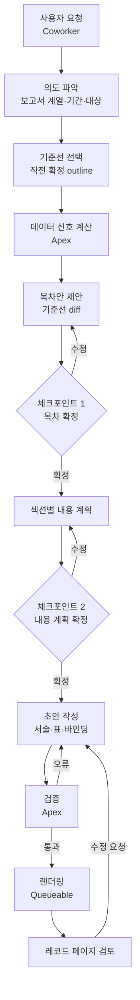
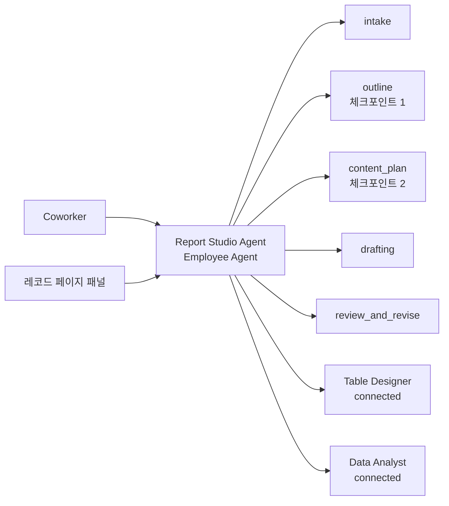

# Salesforce 네이티브 보고서 생성 시스템 설계안 v2

작성일: 2026-10-20 · 대상: Agentforce 기반 DOCX 보고서 자동 생성 (Apex 렌더링)

---

## 0. v1 대비 변경 요약

| 항목 | v1 | v2 |
|---|---|---|
| DRM | 선결 리스크로 상세 분석 | 제외. 전제는 "Salesforce에 업로드된 파일은 Apex로 파싱 가능"뿐 |
| 템플릿화 단위 | 목차 섹션마다 content control 슬롯 | **섹션 카탈로그** 단위. 목차는 매번 조합 |
| 템플릿 DOCX 역할 | 섹션 슬롯을 담은 고정 문서 | 서식 원본(스타일·번호·페이지) + **고정 영역 슬롯만** (표지·본문·부록·결재란) |
| 목차 결정 | 템플릿 선택으로 사실상 고정 | 직전 확정 목차(기준선) + 데이터 신호 + 사용자 대화로 diff 확정 |
| 사용자 확인 | 최종 보고서 검토 | 체크포인트 2회(목차 확정, 섹션별 내용 계획 확정) + 최종 검토 |
| 본문 수치 | LLM 서술 + 검증 | **상대 기간 데이터 바인딩**. 수치·증감 방향 단어를 Apex가 채움 |
| 카탈로그 밖 섹션 | 미고려 | **구조 원형**으로 수용, 반복되면 카탈로그로 승격 |

---

## 1. 목표와 전제

### 1.1 목표
- 사용자는 **Agentforce Coworker에서 요청**하고, **레코드 페이지에서 최종 보고서를 확인**합니다. 보고서 확인 UI는 이미 구현되어 있습니다.
- 보고서는 고정된 서식 계열을 따르되, 목차와 내용은 분기마다 조금씩 다릅니다.
- 에이전트가 목차, 내용, 서식 선택, 표 구성, 데이터 구성을 판단하고, 사용자와 함께 확정합니다.
- 생성물은 기존 보고서와 **거의 동일한 서식**을 갖춘 DOCX입니다. 서식에는 폰트, 줄간격, 색상, 밑줄, 정렬, 여백 등 페이지 레이아웃이 포함됩니다.

### 1.2 전제
- Salesforce에 업로드된 DOCX는 Apex에서 `Compression.ZipReader`(Spring '25 이후 제공)로 열고 XML 파서로 해석할 수 있습니다.
- 표 구조는 기존에 설계한 **matrix-table v1 / matrix-layout v1 / DSL**과 **테두리 가중치(0/1/2, header/body 구분선, boxes)** 스펙을 따릅니다. 재귀 깊이 확장을 포함합니다.

### 1.3 이 문서의 중점
1. Apex 환경에서의 DOCX 서식 적용
2. 복합 표의 OOXML 적용
3. 에이전트가 목차·내용·서식·표·데이터를 판단하고 사용자와 확정하는 구조

---

## 2. 핵심 설계 원칙

1. **3층 분리**: 서식(분위기)·구조(목차)·내용을 분리하고, 각 층의 결정 주체와 변경 주기를 다르게 둡니다.
2. **서식 일관성은 구조로 보장합니다.** 에이전트에게는 원시 서식(폰트, pt, 색상 hex, 여백)을 지정할 수단이 없습니다. 섹션의 블록 패턴과 profile의 닫힌 스타일 목록만 선택할 수 있습니다.
3. **LLM은 판단과 서술, Apex는 계산과 렌더링.** 숫자 계산, 증감 방향, 좌표, 병합, 테두리, 번호 매기기는 모두 결정적으로 처리합니다.
4. **무에서 만들지 않고 기준선에서 고칩니다.** 목차와 본문 모두 직전 확정본을 출발점으로 하여 변경분만 판단합니다.
5. **에이전트 간에는 ID만 주고받습니다.** 본문과 JSON은 레코드에 저장하고, 액션은 ID·요약·오류만 반환합니다(액션 출력 65,000자 절단 대응).

---

## 3. 3층 모델

| 층 | 대상 | 변경 주기 | 결정 주체 | 저장 위치 |
|---|---|---|---|---|
| 서식 | Format Profile: 문단·문자 스타일, 표 프리셋, 페이지, 번호 | 보고서 계열당 고정 | 템플릿 소유자 | `Template_Profile__c` |
| 구조 | Outline: 섹션 카탈로그에서 고른 섹션의 순서·계층 | 매 보고서 | 에이전트 제안 → 사용자 확정 | `Report__c.Outline_JSON__c`, `Report_Section__c` |
| 내용 | 섹션별 블록(서술, 표, 목록) + 데이터 바인딩 | 매 보고서 | 에이전트 작성 → 사용자 확인 | `Report_Block__c` |

### 3.1 서식층: Format Profile

템플릿 DOCX에서 1회 추출하여 저장합니다. 템플릿 파일이 바뀔 때(checksum 변경)만 다시 추출합니다.

**저장용 JSON (요약)**

```json
{
  "profileVersion": "fp-1",
  "templateId": "TPL-IR-QUARTERLY",
  "sourceChecksum": "sha256:…",
  "page": {"size": "A4", "orient": "portrait", "marginsTwip": [1701, 1440, 1440, 1440]},
  "fixedSlots": ["cover", "body", "appendix", "signoff"],
  "headingLevels": {"1": "H1", "2": "H2", "3": "H3"},
  "paraStyles": {
    "H1":      {"styleId": "1",  "font": {"ea": "맑은 고딕", "latin": "Arial"}, "sizePt": 16, "bold": true, "color": "1F3864", "numbering": "heading"},
    "BODY":    {"styleId": "a0", "sizePt": 10, "align": "both", "spacing": {"afterPt": 4, "line": 1.6}},
    "BULLET1": {"styleId": "ListBullet"},
    "NOTE":    {"styleId": "Note", "sizePt": 9, "italic": true},
    "CAPTION": {"styleId": "Caption", "sizePt": 9}
  },
  "charStyles": {"EMPH": {"styleId": "Strong"}, "ACCENT": {"styleId": "AccentRed"}, "UL": {"styleId": "UnderlineChar"}},
  "tablePresets": {
    "FIN_MATRIX": {"fontPt": 9, "headerShade": "D9E2F3",
                   "edge": {"1": {"val": "single", "sz": 4, "color": "808080"}, "2": {"val": "single", "sz": 12, "color": "000000"}},
                   "numAlign": "right", "repeatHeader": true}
  },
  "contentWidthTwip": 9355
}
```

**에이전트용 DSL** (1~2KB). 에이전트는 이것만 읽습니다.

```
PAGE A4 P M(30,25.4,25.4,25.4)mm W=165mm
HEAD H1 H2 H3 (자동 번호)
P BODY=10 just 1.6 | BULLET1=list | NOTE=9 i | CAPTION=9
C EMPH=bold ACCENT=red UL=underline
T FIN_MATRIX=9pt hdr-shade e1=0.5pt e2=1.5pt num→right repeatHdr
```

### 3.2 구조층: 섹션 카탈로그와 Outline
4장에서 상세히 다룹니다.

### 3.3 내용층: 블록과 데이터 바인딩
7장 계약에서 상세히 다룹니다. 핵심은 다음 두 가지입니다.
- 서술 블록은 닫힌 스타일 마크업으로 씁니다.
- 수치와 증감 방향 단어는 **상대 기간 바인딩**으로 쓰고, 렌더 시점에 Apex가 채웁니다.

---

## 4. 섹션 카탈로그

목차 전체가 아니라 **섹션이 템플릿화의 단위**입니다. 목차는 매 보고서마다 카탈로그의 섹션들을 조합한 결과입니다.

### 4.1 두 층 구성

| 층 | 정의 | 예 |
|---|---|---|
| **내용 유형** (content type) | 블록 패턴 + 데이터 요구 + 포함 조건 + 과거 예시가 붙은 섹션 | `summary`, `segment_perf`, `segment_detail`, `risk`, `ytd_review` |
| **구조 원형** (archetype) | 내용과 무관하게 블록 패턴만 정의. 카탈로그 밖 섹션을 받는 그릇 | `narrative`, `narrative_table`, `bullets`, `table_only`, `comparison` |

모든 내용 유형은 하나의 구조 원형을 기반으로 합니다. 서식의 분위기는 원형 단계에서 이미 고정됩니다.

### 4.2 내용 유형 스키마

```json
{
  "type": "segment_perf",
  "archetype": "narrative_table",
  "title": "사업부별 실적",
  "level": 1,
  "when": {"rule": "always"},
  "blocks": [
    {"role": "개요",      "style": "BODY",    "maxSentences": 3},
    {"role": "실적표",    "table": "segment_quarterly", "preset": "FIN_MATRIX"},
    {"role": "주요 변동", "style": "BULLET1", "min": 2, "max": 4}
  ],
  "children": {"type": "segment_detail", "repeatFor": "segments"},
  "data": ["segment.revenue", "segment.op"],
  "exemplars": ["RPT-2025Q2:sec-02", "RPT-2025Q1:sec-02"]
}
```

| 필드 | 의미 |
|---|---|
| `archetype` | 기반이 되는 구조 원형 |
| `title` | 제목 템플릿. 변수 사용 가능(`{segment} 실적`). 번호는 Word 다단계 번호가 자동 부여 |
| `when` | 포함 조건. `always`, `period:Q4`, `signal:<신호명>`, `manual`(사용자 요청 시만) |
| `blocks` | 블록 패턴. 각 블록은 profile 스타일 또는 표 템플릿·프리셋만 참조 |
| `children` | 하위 섹션 유형과 반복 기준(예: 사업부마다 1개) |
| `data` | 필요한 데이터 범주. 데이터 요청 계획 생성에 사용 |
| `exemplars` | 과거 보고서의 해당 섹션 블록 참조. 서술 톤과 구성의 출발점 |

### 4.3 구조 원형

| 원형 | 블록 패턴 |
|---|---|
| `narrative` | BODY 문단 1~N |
| `narrative_table` | 개요 BODY + 표 + 요점 BULLET1 |
| `bullets` | 도입 BODY 1문장 + BULLET1 목록 |
| `table_only` | CAPTION + 표 + NOTE |
| `comparison` | 개요 BODY + 비교표 + 시사점 BULLET1 |

원형은 템플릿 소유자가 관리하며, 5~6개 수준으로 유지합니다.

### 4.4 카탈로그 밖 섹션 처리

사용자가 카탈로그에 없는 섹션을 원할 때 에이전트는 다음 순서로 처리합니다.

1. **기존 유형의 변형인지 확인합니다.** 제목만 다르거나 대상(사업부·지표)만 다르면 기존 유형을 사용합니다.
2. 아니면 **가장 맞는 구조 원형을 고르고 사용자에게 확인**합니다("이 섹션은 개요 + 표 + 요점 형태로 넣겠습니다").
3. 목차안에는 카탈로그 밖 섹션임을 `*`로 표시합니다.
4. 필요한 수치가 기존 데이터 원천에 없으면 **수치를 만들지 않고** 사용자에게 원천을 묻습니다. 사용자가 직접 준 값은 `source: manual`과 출처를 기록합니다.

**표현할 수 없는 요청의 경계.** 어떤 원형으로도 표현할 수 없는 시각 요소(차트, 2단 배치, 새 강조 스타일)는 그 자리에서 만들지 않습니다. 에이전트는 한계를 밝히고 가장 가까운 원형을 제안합니다. 꼭 필요하면 템플릿 소유자가 profile·원형을 확장하는 절차로 넘깁니다.

### 4.5 승격

- 카탈로그 밖 섹션도 원형, 제목, 블록, 사용 데이터와 함께 `Report_Section__c`(`Adhoc__c = true`)로 저장합니다.
- 정규화한 제목과 원형이 같은 섹션이 **2개 이상의 확정 보고서**에 등장하면 승격 후보로 올립니다.
- 관리자가 레코드 페이지에서 포함 조건, 데이터 범주, 예시를 붙여 내용 유형으로 확정합니다. 승격 판단은 에이전트 범위 밖에 둡니다.

### 4.6 초기 카탈로그 구축

1. 과거 확정 보고서 DOCX를 Salesforce에 업로드합니다.
2. Apex가 각 문서에서 제목 문단(Heading 스타일/outlineLvl)과 그 아래 블록 구성(문단 스타일 순서, 표 유무)을 추출합니다.
3. 에이전트가 제목 문구와 블록 구성을 기준으로 섹션 유형 후보를 묶어 제안합니다.
4. 사람이 유형명, 포함 조건, 데이터 범주를 다듬어 확정합니다.
5. 이후에는 새 보고서가 확정될 때마다 outline과 블록이 이력으로 쌓여 `exemplars`와 기준선으로 쓰입니다.

---

## 5. 목차·내용 결정 흐름 (Human-in-the-loop)

### 5.1 전체 흐름



### 5.2 기준선 선택

- 기본: 같은 보고서 계열의 **직전 확정 보고서** outline
- 분기 특수성이 있는 경우(예: Q4·연간): **전년 동분기 확정 보고서**도 함께 후보로 제시
- 에이전트는 어떤 기준선을 썼는지 사용자에게 밝힙니다.

### 5.3 데이터 신호 (Apex, 결정적)

| 신호 | 계산 |
|---|---|
| `new_segment` / `removed_segment` | 기준선 대비 데이터상 사업부 등장·소멸 |
| `threshold:<지표>` | 섹션 유형 `when`에 정의된 임계치 초과(예: 사업부 매출 QoQ 절대값 10% 이상) |
| `period:Q4` 등 | 보고 기간 속성 |
| `missing_data:<범주>` | 기준선 섹션이 쓰던 데이터가 이번 기간에 없음 |

신호는 판단 근거로만 제공되며, 섹션의 포함 여부는 에이전트가 제안하고 사용자가 확정합니다.

### 5.4 체크포인트 1: 목차 확정

에이전트는 기준선 대비 diff로 제안합니다.

```
OUTLINE ir_quarterly  period=2025Q3  base=RPT-2025Q2
1    실적 요약        [summary]            =
2    사업부별 실적    [segment_perf]       =
2.1    게임           [segment_detail]     =
2.2    반도체         [segment_detail]     +  신호 new_segment (매출 +18%)
3    리스크 요인      [risk]               -  신호 없음, 특이사항 없음
4    ESG 이슈         [*narrative_table]   +  사용자 요청 (카탈로그 외)
```

기호: `=` 유지, `+` 추가, `-` 제외, `~` 유형 유지·제목 변경, `*` 카탈로그 외(원형 사용).

사용자가 대화로 수정하고("리스크는 남겨줘") 확정하면 outline이 저장되고 다음 보고서의 기준선이 됩니다.

### 5.5 체크포인트 2: 섹션별 내용 계획 확정

섹션마다 다음을 짧게 제시하고 확정받습니다.

```
2.2 반도체 [segment_detail]
  메시지: 신규 편입, 3Q 매출 전분기 대비 증가 견인
  표: segment_quarterly (반도체 단독, 2024 1Q~2025 3Q, QoQ·YoY)
  출발점: 신규 섹션 (예시 없음 → 2.1 게임 섹션 구성 참조)
```

### 5.6 초안 작성과 기준선 활용

- 각 섹션의 초안은 **기준선의 같은 섹션 블록을 출발점**으로 고쳐 씁니다. 톤과 구성이 유지되고 변경분만 서술하면 됩니다.
- 기준선 블록은 **상대 기간 바인딩**으로 저장되어 있으므로, 수치는 새 기간 값으로 자동 갱신됩니다. 에이전트는 바뀐 사실관계의 서술만 수정합니다.
- 한 번의 LLM 호출이 한 섹션만 다룹니다. 추론 타임아웃과 출력 토큰 한도를 피하기 위해서입니다.

---

## 6. 에이전트 구성

### 6.1 플랫폼 구성요소 (2026년 10월 기준)

| 구성요소 | 상태 | 역할 |
|---|---|---|
| Agentforce Coworker | **Beta** (2026-05 발표). Help FAQ: "Beta: English only" | 사용자 진입점. 요청을 Employee Agent로 위임 |
| Employee Agent | GA, Agentforce Builder(Agent Script) | 보고서 작성 오케스트레이터 |
| Subagent | GA (구 Topic) | 에이전트 내부 업무 단위 |
| Connected Subagent (Multi-Agent Orchestration) | Winter '27 **GA** | 표 설계·데이터 전문 에이전트 분리 |
| Agent Actions | Apex `@InvocableMethod`, Flow, Prompt Template | 결정적 처리의 통로 |
| Prompt Template (Flex) | GA, Apex에서 호출 가능 | Queueable 내부의 섹션 단위 생성(선택) |

**Coworker 리스크 격리.** Beta 기간에는 영어만 지원하고, 커스텀 에이전트 위임 설정은 공식 문서로 확인하지 못했습니다. 따라서 **레코드 페이지의 Employee Agent 패널에서도 동일하게 동작**하도록 설계하여, Coworker는 진입점으로만 둡니다.

### 6.2 역할 분리



| 주체 | 판단 내용 | 사용 액션 |
|---|---|---|
| `intake` | 보고서 계열, 기간, 대상 엔터티 파악 | `ListReportFamilies` |
| `outline` | 기준선 선택, 섹션 추가·제외, 카탈로그 외 섹션 원형 선택, 사용자와 목차 확정 | `GetBaselineOutline`, `ComputeSignals`, `GetCatalogDsl`, `ValidateOutline`, `SaveOutline` |
| `content_plan` | 섹션별 메시지, 표 구성, 데이터 범위 제안·확정 | `GetSectionContext`, `SaveContentPlan` |
| `drafting` | 섹션 서술(마크업 + 바인딩), 서식 선택(닫힌 목록) | `GetSectionContext`, `SaveBlock`, `ValidateBlocks` |
| `review_and_revise` | 검증 오류 수정, 레코드 페이지 피드백 반영 | `GetValidationErrors`, `SaveBlock` |
| Table Designer | 표 레이아웃(matrix-layout) 설계, 표 서식 선택 | `CompileTableLayout`, `ValidateTableFormat` |
| Data Analyst | 데이터 요청 이행, 원천 조회, 비정형 원천 시 값 채움 | `FetchMetricValues`, `SaveValues` |
| Apex (결정적) | 신호 계산, 검증, 바인딩 해석, 파생값 계산, 렌더링 | `SubmitRender`, `GetRenderStatus` |

**진화 경로.** MVP는 단일 Employee Agent + subagent 5개로 시작하고, 표·데이터 기능은 subagent로 둡니다. 품질과 재사용성이 필요해지면 connected subagent로 분리합니다. Beta 시점 Admin 블로그 기준으로 `transition to`로는 connected subagent에 직접 라우팅할 수 없어, connected subagent를 호출하는 액션을 invoke해야 했습니다. GA 이후 변경 여부는 확인이 필요합니다.

### 6.3 장시간 작업 패턴

에이전트 액션은 60초에 타임아웃되므로 렌더링은 액션 안에서 끝내지 않습니다.

1. `SubmitRender`가 `Report__c.Status__c = Queued`로 바꾸고 Queueable을 enqueue한 뒤 requestId를 즉시 반환합니다.
2. Queueable 체인이 검증 → 바인딩 해석 → 렌더링 → 저장을 수행합니다.
3. 완료 시 Platform Event(`Report_Status__e`)를 발행하고, 레코드 페이지 LWC가 이를 받아 갱신합니다.
4. 에이전트는 `GetRenderStatus`로 상태를 확인해 사용자에게 링크를 안내합니다.

---

## 7. 에이전트 계약

모든 액션 입력은 **JSON 문자열 단일 파라미터**입니다. 커스텀 액션 입력은 primitive 타입만 허용되기 때문입니다.

### 7.1 Outline JSON

```json
{
  "outlineVersion": "ol-1",
  "reportFamily": "ir_quarterly",
  "period": "2025Q3",
  "baseline": "RPT-2025Q2",
  "sections": [
    {"id": "s1", "type": "summary", "change": "="},
    {"id": "s2", "type": "segment_perf", "change": "=", "children": [
      {"id": "s2a", "type": "segment_detail", "params": {"segment": "게임"}, "change": "="},
      {"id": "s2b", "type": "segment_detail", "params": {"segment": "반도체"}, "change": "+", "reason": "signal:new_segment"}
    ]},
    {"id": "s4", "archetype": "narrative_table", "adhoc": true, "title": "ESG 이슈", "change": "+", "reason": "user_request"}
  ],
  "excluded": [{"type": "risk", "reason": "no_signal"}]
}
```

검증 규칙:
- `type`은 카탈로그에 존재해야 합니다. `adhoc`이면 `archetype`이 존재해야 합니다.
- 계층 깊이는 profile의 `headingLevels` 이내여야 합니다.
- `children`의 type은 부모 유형의 `children.type`과 일치해야 합니다.

### 7.2 내용 계획 JSON

```json
{"sectionId": "s2b", "message": "신규 편입, 3Q 매출 전분기 대비 증가 견인",
 "tables": [{"id": "t3", "template": "segment_quarterly", "scope": {"segment": "반도체"}}],
 "dataRange": {"from": "2024Q1", "to": "2025Q3"}, "startFrom": "s2a"}
```

### 7.3 서술 마크업 (닫힌 스타일 + 바인딩)

```
@BODY 반도체 부문 매출은 {v:sony.rev.semi@CUR}로 전분기 대비 {v:sony.rev.semi@CUR.QoQ} {trend:sony.rev.semi@CUR.QoQ}했다.
@BULLET1 {EMPH|이미지센서} 수요 회복이 주요인
@BULLET1 영업이익률은 {v:sony.opm.semi@CUR} 수준
@NOTE 주: 연결 기준
```

| 문법 | 의미 |
|---|---|
| `@STYLE` (줄 머리) | profile `paraStyles` 키만 허용, 섹션 블록 패턴과 일치해야 함 |
| `{STYLE\|text}` | profile `charStyles` 키만 허용, 중첩 금지 |
| `{v:<rowKey>@<period>}` | 수치 바인딩. 포맷은 지표 정의를 따름 |
| `{trend:<rowKey>@<period>.<delta>}` | 증감 방향 단어. 값의 부호로 "증가/감소/보합"을 Apex가 결정 |
| `\{` `\}` `\@` | 이스케이프 |

**상대 기간 토큰**: `CUR`(보고 기간), `PREV`(직전 분기), `CUR-4`(전년 동분기), `CUR.QoQ`, `CUR.YoY`, `FY`, `FY-1`.
기준선 블록을 다음 분기에 재사용하면 바인딩은 새 기간 값으로 자동 해석됩니다.

**원시 서식 지정 문법은 없습니다.** 폰트, 크기, 색상, 정렬을 표현할 방법 자체를 두지 않는 것이 서식 일관성의 가장 강한 장치입니다.

### 7.4 표 계약

| 단계 | 형식 | 주체 |
|---|---|---|
| 레이아웃 | matrix-layout v1 JSON (재귀 깊이 포함, decomposition 자기점검) | Table Designer |
| 데이터 요청 | compiler가 생성한 원천 값 목록(파생값 제외) | Apex |
| 값 | `{"cells": {"<rowKey>@<period>": number}}`, compiler 발급 키만 허용 | Data Analyst / 조회 액션 |
| 표 서식 | preset + 허용 옵션(열 폭 비율, 숫자 포맷, boxes, 강조 행) | Table Designer |
| 과거 표 참조 | 압축 DSL (`COLS 2024[1Q 2Q 3Q 4Q 계^] …`) | 컨텍스트 절약 |

표 안의 수치와 본문 바인딩은 같은 값 저장소를 참조하므로 서로 어긋날 수 없습니다.

### 7.5 검증 오류 형식 (모든 Validate* 공통)

```json
{"ok": false, "errors": [
  {"code": "SECTION_TYPE_UNKNOWN", "path": "outline/sections/3", "msg": "type 'esg' not in catalog; use archetype with adhoc=true"},
  {"code": "STYLE_NOT_IN_PATTERN", "path": "blk:s2b-1/line3", "msg": "NOTE not allowed in segment_detail", "allowed": ["BODY", "BULLET1"]},
  {"code": "BINDING_KEY_UNKNOWN", "path": "blk:s2b-1/line1", "msg": "sony.rev.semi@CUR not in values"},
  {"code": "BOX_CUTS_MERGE", "path": "tbl:t3/format/boxes/0", "msg": "box edge crosses merged cell r1c2:r1c3"}
]}
```

`review_and_revise`가 오류를 받아 최대 2회 수정하고, 계속 실패하면 사용자에게 요약을 보여준 뒤 기본 패턴·preset으로 폴백합니다.

---

## 8. Apex DOCX 처리

### 8.1 Profile 추출

| 파트 | 추출 항목 |
|---|---|
| `word/styles.xml` | docDefaults, 문단·문자·표 스타일, `basedOn` 체인, 표 조건부 서식 |
| `word/theme/theme1.xml` | 테마 폰트(`a:ea`, `script="Hang"` 포함) |
| `word/numbering.xml` | 제목·목록 번호 정의 |
| `word/document.xml` | 최종 `w:sectPr`(용지·여백·머리글/바닥글 참조), 고정 슬롯 `w:sdt` 태그, 제목 문단 |
| `word/settings.xml` | 기본 탭, `updateFields` |

- **단위**: 여백·폭은 twip(1/20pt), 글자 크기 `w:sz`는 half-point, 줄간격 `lineRule="auto"`는 1/240줄, 테두리 `w:sz`는 1/8pt
- **한글 폰트**: `w:rFonts`의 `w:eastAsia`·`w:eastAsiaTheme`과 `w:lang w:eastAsia="ko-KR"`을 보존·기록
- **유효 서식 해석 순서**(ECMA-376 §17.7.2): docDefaults → 표 스타일 → 번호 → 문단 스타일 → 문자 스타일 → 직접 서식. 토글 속성(b, i 등)은 스타일 계층에서 XOR로 동작
- 생성 시에는 스타일 ID만 쓰고 해석은 Word에 맡깁니다. Apex의 해석 결과는 profile DSL과 HTML 미리보기에만 사용하므로, 해석 엔진에 오차가 있어도 출력 DOCX의 충실도에는 영향이 없습니다.
- **파서 선택**: styles·numbering·theme은 `Dom.Document`, document.xml은 `XmlStreamReader`로 필요한 부분만 수집합니다. Queueable(heap 12MB, CPU 60s)에서 실행합니다.

### 8.2 템플릿 구조

템플릿 DOCX에는 고정 영역만 content control 슬롯으로 둡니다.

| 슬롯 tag | 내용 |
|---|---|
| `cover` | 표지(제목, 기간, 작성 부서 등 필드 치환) |
| `toc` | Word TOC 필드 |
| `body` | **outline 순서대로 렌더러가 생성하는 본문 전체** |
| `appendix` | 부록(선택) |
| `signoff` | 결재란 등 고정 요소 |

### 8.3 본문 생성

1. outline을 깊이 우선으로 순회하며 섹션마다 제목 문단을 만듭니다. 깊이에 맞는 Heading 스타일(`H1`/`H2`/`H3`)을 적용하고, **번호는 템플릿의 다단계 번호(numbering.xml)가 자동 부여**합니다. 에이전트가 번호를 쓰지 않습니다.
2. 섹션 유형(또는 원형)의 블록 패턴 순서대로 블록을 출력합니다.
   - 서술 블록: 마크업 → `w:p`(`w:pStyle`) + `w:r`(`w:rStyle`)
   - 바인딩: 값 저장소에서 해석해 지표별 포맷으로 출력, `trend`는 부호로 단어 결정
   - 표 블록: 8.4의 OOXML 표 렌더러
3. 생성한 본문을 `body` 슬롯의 `<w:sdtContent>` 구간에 **문자열 치환**으로 넣습니다. 나머지 XML은 바이트 그대로 보존합니다.
4. `settings.xml`에 `<w:updateFields w:val="true"/>`를 추가해, 문서를 열 때 목차·쪽번호 갱신을 유도합니다. 레코드 페이지 미리보기용 목차는 outline에서 별도 생성합니다.

**출력 규칙**: XML 이스케이프(`& < > " '`)와 XML 1.0 금지 제어문자 제거, 앞뒤 공백이 있는 텍스트는 `xml:space="preserve"`, 탭은 `<w:tab/>`, 단락 내 줄바꿈은 `<w:br/>`, 페이지 나눔은 `<w:br w:type="page"/>`. 폰트는 스타일이 결정하므로 run에 `w:rFonts`를 쓰지 않습니다.

```xml
<w:p><w:pPr><w:pStyle w:val="2"/></w:pPr><w:r><w:t>반도체</w:t></w:r></w:p>
<w:p><w:pPr><w:pStyle w:val="a0"/></w:pPr>
  <w:r><w:t xml:space="preserve">반도체 부문 매출은 </w:t></w:r>
  <w:r><w:t>5,200</w:t></w:r>
  <w:r><w:t xml:space="preserve">억 엔으로 전분기 대비 </w:t></w:r>
  <w:r><w:rPr><w:rStyle w:val="AccentRed"/></w:rPr><w:t>+8.3%</w:t></w:r>
  <w:r><w:t xml:space="preserve"> 증가했다.</w:t></w:r>
</w:p>
```

### 8.4 OOXML 표 렌더러 (matrix-table → `w:tbl`)

HTML 렌더러와 **같은 resolved-edge 중간표현**을 공유합니다(`MatrixTableCompiler` → `EdgeResolver` → `OoxmlTableWriter` / `MatrixTableRenderer`). 레코드 페이지 미리보기와 DOCX가 같은 결과를 냅니다.

| 요소 | 규칙 |
|---|---|
| 열 폭 | profile `contentWidthTwip`을 비율로 분배. `w:gridCol`과 `w:tcW`(dxa) 일치, `w:tblLayout fixed`. 반올림 오차는 마지막 열이 흡수 |
| 가로 병합 | 시작 셀에 `w:gridSpan`, 이어지는 셀은 출력하지 않음 |
| 세로 병합 | 시작 셀 `w:vMerge w:val="restart"`, 아래 행의 같은 위치에 `w:vMerge` continue 셀을 **반드시 출력**(가로 병합이 함께면 같은 `gridSpan`) |
| 테두리 | 표 수준 `w:tblBorders`는 모두 `nil`, 모든 테두리를 셀 단위로 명시. **공유 edge는 양쪽 셀에 같은 값을 기록**해 충돌이 생기지 않게 함 |
| edge weight | profile preset 매핑. 예: 0 → `nil`, 1 → `single sz=4`, 2 → `single sz=12`. header/body 구분선 기본 2 |
| 표 스타일 간섭 차단 | `w:tblLook`의 조건부 플래그를 모두 0 |
| 헤더 반복 | 헤더 행 `w:trPr`에 `<w:tblHeader/>` |
| 셀 서식 | 헤더 음영 `w:shd`, `w:vAlign center`, 숫자 셀 `w:jc right`, 셀 문단은 표 전용 스타일 |
| spacer 행/열 | 소속 표현용 빈 셀. 계산된 edge만 반영, 최소 폭 |

```xml
<w:tc>
  <w:tcPr>
    <w:tcW w:w="1871" w:type="dxa"/><w:vMerge w:val="restart"/>
    <w:tcBorders>
      <w:top w:val="single" w:sz="12" w:color="000000"/><w:left w:val="nil"/>
      <w:bottom w:val="single" w:sz="12" w:color="000000"/><w:right w:val="single" w:sz="4" w:color="808080"/>
    </w:tcBorders>
    <w:shd w:val="clear" w:color="auto" w:fill="D9E2F3"/><w:vAlign w:val="center"/>
  </w:tcPr>
  <w:p><w:pPr><w:pStyle w:val="TableHeader"/></w:pPr><w:r><w:t>구분</w:t></w:r></w:p>
</w:tc>
```

### 8.5 재패키징, 저장, heap 전략

- 템플릿 ZipReader의 엔트리를 순회하며, 변경된 `word/document.xml`과 `word/settings.xml`만 새 Blob으로 넣고 나머지는 그대로 복사해 `ZipWriter`로 재패키징합니다.
- 본문과 표만 넣는 범위에서는 `[Content_Types].xml`과 `.rels` 갱신이 필요 없습니다. 이미지·차트 삽입은 MVP 범위에서 제외합니다.
- `ContentVersion`(`FirstPublishLocationId = Report__c.Id`)으로 저장하고 `Report__c.Latest_Version_Id__c`를 갱신합니다. 재생성은 버전 이력으로 남습니다.
- heap: 템플릿 Blob + 엔트리 복사본 + 새 아카이브를 감안해 **템플릿 3~4MB 이하**를 운영 가이드로 둡니다(추정치, PoC에서 실측).

### 8.6 테스트

1. **단위**: compiler·EdgeResolver 골든 테스트, 마크업 파서(허용·금지 스타일, 이스케이프), 바인딩 해석(상대 기간, 결측값, 부호와 trend 단어)
2. **정합성**: 생성한 document.xml을 `Dom.Document.load()`로 재파싱해 well-formed를 확인하고, 행마다 grid 합계와 gridCol 수가 같은지 단언
3. **시각 회귀**: 대표 보고서 10종을 Word에서 열어 기준본과 비교
4. **한도**: 최대 크기 템플릿 + 표 30개 + 50쪽 분량으로 Queueable heap·CPU 실측

---

## 9. 데이터 모델

| 객체 | 핵심 필드 |
|---|---|
| `Report_Family__c` | 보고서 계열(예: IR 분기), Template__c, 기본 기준선 규칙 |
| `Report_Template__c` | Source_ContentVersion_Id__c, Active__c |
| `Template_Profile__c` | Template__c, Profile_JSON__c, Profile_DSL__c, Source_Checksum__c, Parser_Version__c |
| `Section_Type__c` | Family__c, Type_Key__c, Archetype__c, Title_Template__c, When_JSON__c, Blocks_JSON__c, Children_JSON__c, Data_JSON__c, Active__c |
| `Section_Archetype__c` | Key__c, Blocks_JSON__c |
| `Report__c` | Family__c, Period__c, Baseline_Report__c, Status__c(Intake/Outline/ContentPlan/Drafting/Validating/Queued/Rendering/Done/Failed), Outline_JSON__c, Latest_Version_Id__c, Error_Summary__c |
| `Report_Section__c` | Report__c, Section_Id__c, Type__c 또는 Archetype__c, Adhoc__c, Title__c, Change__c, Reason__c, Content_Plan_JSON__c, Order__c, Parent__c |
| `Report_Block__c` | Report_Section__c, Block_Id__c, Role__c, Kind__c(prose/table), Markup__c, Layout_JSON__c, Format_JSON__c, Validation_JSON__c |
| `Report_Value__c` (또는 JSON 필드) | Report__c, Key__c(`rowKey@period`), Value__c, Source__c(system/manual), Source_Note__c |
| `Report_Status__e` | Report_Id__c, Status__c |
| ContentVersion | 템플릿 원본, 과거 보고서, 생성 DOCX |

승격 후보는 `Report_Section__c`에서 `Adhoc__c = true`이고 정규화 제목·원형이 같은 레코드를 집계해 산출합니다.

---

## 10. 플랫폼 제약과 대응

| 제약 (공식) | 값 | 대응 |
|---|---|---|
| 에이전트 액션 타임아웃 | 60초 | 렌더링은 Queueable + requestId |
| 추론 요청 타임아웃 | 30초 | 섹션 단위 생성 |
| 액션 출력 | 65,000자 초과 시 절단 | ID·요약·오류만 반환 |
| 커스텀 액션 입력 | primitive 타입만 | JSON 문자열 단일 파라미터 |
| 권장 구성 | subagent당 액션 10개 이하, 에이전트당 subagent 10개 이하 | 6.2 역할 분리 범위 내 유지 |
| subagent·action 지시문 | 영어만 지원 | 지시문은 영어로, 출력 언어는 한국어로 명시 |
| Prompt Builder | 템플릿 128,000자, Flex 입력 5개 | profile·카탈로그·과거 표는 DSL로 압축 |
| Trust Layer 마스킹 ON | Models API 문서 기준 컨텍스트 65,536 토큰 (에이전트 경로 적용 여부 확인 필요) | DSL 압축, 섹션 단위 호출 |
| Apex | heap 6MB/12MB, CPU 10s/60s | 파싱·렌더링은 Queueable |

---

## 11. 대안 비교

| 기준 | 네이티브 Apex (본 설계) | OmniStudio / Salesforce Document Generation | MuleSoft·외부 서비스 |
|---|---|---|---|
| 서식 충실도 | 템플릿 바이트 보존으로 매우 높음 | 템플릿 기반으로 높음. 서버 측은 지원 폰트 집합 제약 | 라이브러리에 따라 최고 수준 |
| 가변 목차 + 섹션 블루프린트 | 직접 구현으로 완전 제어 | 토큰·반복 구간 중심. 섹션 조합형 문서에는 부적합 | 완전 제어 |
| 동적 병합 표·셀 단위 테두리 | 완전 제어 | 공식 근거를 확인하지 못함 | 완전 제어 |
| 에이전트·레코드 경계 | 플랫폼 내부 완결 | 플랫폼 내부 | 외부 경유 |
| 비용·운영 | 추가 라이선스 없음, 개발 부담 큼 | 라이선스 필요 | vCore·상용 라이브러리·인프라 |

**권고**: 렌더링 코어는 네이티브 Apex로 하고, 렌더러를 `IDocxRenderer` 인터페이스로 추상화합니다. PDF 출력이나 차트 이미지가 필수가 되면 외부 렌더러로 일부 단계를 옮길 수 있게 둡니다.

---

## 12. 단계별 계획

| 단계 | 기간(제안) | 범위 | 완료 기준 |
|---|---|---|---|
| **PoC** | 3~4주 | 템플릿 1종 profile 추출, 과거 보고서 3~5건에서 섹션 후보 추출, outline 1개 + 섹션 3개 + matrix 표 1개 렌더, 바인딩 해석, heap·CPU 실측, Coworker 위임 동작 확인 | Word에서 기존 보고서와 서식 차이 없음, 12MB 이내 |
| **MVP** | 6~8주 | 카탈로그 1계열(내용 유형 10~15개 + 원형 5개), 체크포인트 2회 포함 대화 흐름, 액션 전체, 검증·재시도, Queueable 렌더, 레코드 페이지 상태 표시 | 실제 분기 보고서 1회 생성, 사용자 수정 2회 이내로 확정 |
| **Hardening** | 6주 이상 | connected subagent 분리, 승격 관리 화면, Testing Center 회귀 스위트, profile 버전 관리, 가로 섹션·이미지 지원, 성능 튜닝 | 운영 SLA, 다계열 확장 |

---

## 13. 리스크와 대응

| 리스크 | 영향 | 대응 |
|---|---|---|
| 카탈로그가 실제 보고서 변형을 다 담지 못함 | 카탈로그 외 섹션 빈발 | 원형으로 수용, 승격 절차로 카탈로그 성장 |
| 원형으로 표현할 수 없는 요청(차트, 2단 등) | 사용자 기대 불일치 | 에이전트가 한계를 밝히고 대안 제시, profile 확장 절차로 이관 |
| 기준선 의존으로 같은 서술이 반복됨 | 보고서 품질 저하 | 체크포인트 2에서 섹션별 메시지를 확정하고, 신호가 있는 섹션은 재작성 필수로 표시 |
| 숫자 환각 | 신뢰도 붕괴 | 본문 수치·증감 단어는 바인딩만 허용, 원천은 결정적 조회 |
| Coworker Beta(영어 전용, 위임 설정 미검증) | 진입점 불안정 | 레코드 페이지 패널을 동등한 경로로 유지 |
| 액션 60초·출력 65,000자 | 타임아웃·절단 | Queueable + ID 참조 + 섹션 단위 처리 |
| heap 12MB | 대형 템플릿 실패 | 엔트리 선택 추출, 문자열 슬롯 치환, 템플릿 크기 가이드 |
| 표 병합·테두리 오류 | Word에서 서식 깨짐 | 공유 edge 양측 동일 기록, continue 셀 강제, 렌더 전 정합성 검증 |
| 템플릿 변경 | profile 불일치 | checksum 기반 재추출, 보고서에 profile 버전 고정 기록 |

---

## 14. 확인이 필요한 사항

1. 보고서 계열은 몇 개이며, 계열별 과거 확정 보고서를 몇 건 정도 확보할 수 있습니까? (카탈로그 초안 품질에 직결)
2. 기준선 규칙: 항상 직전 분기입니까, 아니면 Q4·연간처럼 전년 동분기를 우선하는 경우가 있습니까?
3. 데이터 신호의 임계치(예: QoQ 10%)는 섹션별로 업무 부서가 정할 수 있습니까?
4. 표 원천 데이터의 위치(Salesforce 객체, Data Cloud, 외부 DW 경유 MuleSoft)는 어디입니까? LLM이 값을 채워야 하는 비정형 원천이 있습니까?
5. 카탈로그·원형·profile의 관리 주체(템플릿 소유자, 승격 승인자)는 누구입니까?
6. 출력은 DOCX만입니까, PDF도 필요합니까?
7. 사용할 LLM과 Trust Layer 데이터 마스킹 정책은 무엇입니까?
8. 조직이 Agentforce Coworker 활성화 대상이며, Beta 약관 수용과 한국어 요청 요건을 어떻게 판단합니까?

---

## 15. 미검증 사항

- Agentforce Coworker의 커스텀 에이전트 위임 설정 방식, Agent Script 필수 여부, 위임 가능 에이전트 수는 공식 문서로 확인하지 못했습니다.
- Connected Subagent GA는 Winter '27 개발자 가이드 블로그에 근거합니다. Beta 시점의 `transition to` 직접 라우팅 제약이 GA에서 해소되었는지는 확인하지 못했습니다.
- 에이전트 액션 입력의 최대 크기는 공식 문서에서 찾지 못했습니다(출력 65,000자 절단만 명시).
- Trust Layer 마스킹 시 65,536 토큰 제한은 Models API 문서 기준이며, 에이전트 경로 적용 여부는 재확인이 필요합니다.
- document.xml 크기, heap 배수 등 수치는 경험적 추정이며 PoC에서 측정해야 합니다.
- ECMA-376 인접 셀 테두리 충돌 규칙과 Word 실제 렌더링의 차이는 상세 검증하지 않았습니다. 본 설계는 충돌이 생기지 않는 출력 방식을 채택해 이 문제를 회피합니다.
