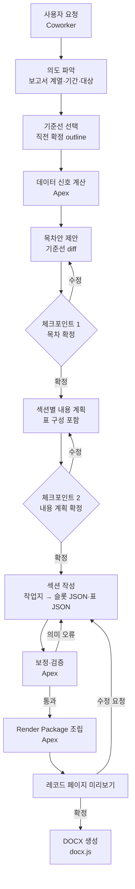
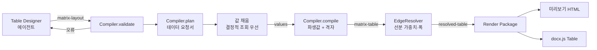
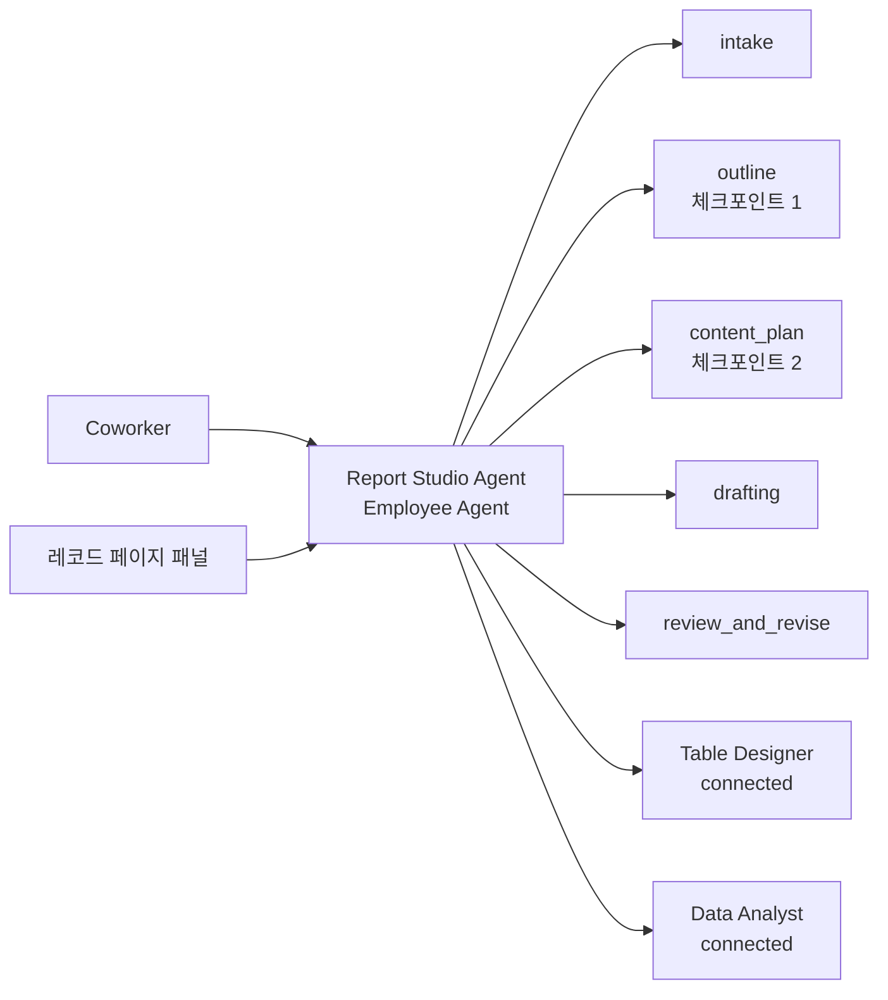

# Salesforce 기반 보고서 생성 시스템 설계안 v5

작성일: 2026-10-20 · 대상: Agentforce 기반 고정 서식 DOCX 보고서 자동 생성

이 문서는 단독으로 읽어도 이해할 수 있도록 작성했습니다.

**핵심 전제**
- DOCX 생성은 **docx.js**가 담당합니다. docx.js는 검증이 끝나 이미 사용 중이며, Apex는 DOCX를 생성하지 않습니다.
- 에이전트는 **문장만** 씁니다. 서술은 Apex가 준 작업지의 슬롯을 채운 **JSON**(수치는 번호 토큰)으로, 표는 **matrix-layout JSON**으로 출력합니다. 태그·순서·서식·데이터 경로는 다루지 않습니다.
- Apex는 파싱·작업지 제공·보정·검증·계산·조립을 맡고, 결과를 **Render Package** 하나로 넘깁니다. 레코드 페이지 미리보기와 docx.js가 같은 Render Package를 사용합니다.

**v4 대비 변경**: 에이전트의 서술 출력을 제한 HTML에서 슬롯 JSON으로 바꾸고(제한 HTML은 Apex 내부 형식으로 전환), 섹션 작업지·값 토큰·역바인딩·자동 보정·기준선 예시·섹션 진행 관리(8장)를 추가했습니다.

---

## 0. 용어

| 용어 | 뜻 |
|---|---|
| 보고서 계열 | 같은 서식을 공유하는 보고서 묶음. 예: "IR 분기 보고서" |
| 템플릿 DOCX | 사람이 Word에서 만든 서식 원본. 스타일·번호·페이지 설정과 자리표시자(`{{body}}` 등)를 담음 |
| Format Profile | 템플릿 DOCX에서 추출한 서식 요약(JSON). 에이전트가 고를 수 있는 스타일 목록이자 렌더러의 매핑표 |
| 섹션 카탈로그 | 보고서에 들어갈 수 있는 섹션 유형 목록. 목차는 매번 이 목록에서 골라 조합 |
| 내용 유형 / 구조 원형 | 카탈로그의 두 층. 내용 유형은 데이터·조건·예시가 붙은 섹션, 구조 원형은 블록 패턴만 정의한 그릇 |
| Outline | 한 보고서의 확정 목차 |
| 기준선 | 새 목차·본문의 출발점이 되는 직전 확정 보고서 |
| 데이터 신호 | Apex가 계산한 판단 근거. 예: 신규 사업부 등장, 임계치 이상 변동 |
| 섹션 작업지 | Apex가 섹션마다 만들어 에이전트에게 주는 텍스트. 슬롯, 값 표, 기준선 예시를 담음 |
| 슬롯 / 슬롯 JSON | 섹션 블루프린트의 빈칸(예: 개요, 주요 변동) / 에이전트가 빈칸을 채워 내는 JSON |
| 값 토큰 | 작업지 값 표의 번호(`{v1}`). 에이전트는 수치를 이 토큰으로만 씀 |
| 역바인딩 | 에이전트가 숫자를 직접 써도 값 표와 일치하면 Apex가 토큰으로 되돌리는 보정 |
| 바인딩 | 저장 시 토큰을 바꿔 넣는 데이터 참조(`소니>매출>반도체@CUR`). 렌더 시 Apex가 값을 채움 |
| 제한 HTML | Apex 내부 형식. 슬롯 JSON을 블루프린트대로 조립한 결과. 허용 태그·클래스만 사용 |
| matrix-layout | 표의 **의미 구조**. 행·열 헤더의 소속 관계만 표현. 에이전트가 작성 |
| matrix-table | 표의 **격자 구조**. 좌표·병합·셀 테두리 플래그까지 확정. 컴파일러가 생성 |
| resolved-table | matrix-table에서 선분 가중치까지 확정한 **렌더 직전 표**. 셀마다 span과 네 변의 굵기를 가짐 |
| 표 DSL | 표 구조를 수백 바이트로 압축한 텍스트 표기. 저장·참조용 |
| spacer | 헤더 단계 사이에 두는 얇은 행/열. 테두리를 켜고 꺼서 소속을 표현 |
| edge weight | 선분의 굵기 등급. 0 숨김, 1 일반, 2 굵게 |
| Render Package | Apex가 조립한 보고서 전체(제목, 제한 HTML 블록, resolved-table, 템플릿 필드). 미리보기와 docx.js의 공통 입력 |
| Coworker | Agentforce Coworker. 사용자 요청 진입점(2026-10 현재 Beta) |
| Employee Agent / subagent / connected subagent | Agentforce의 에이전트, 에이전트 내부 업무 단위, 하위로 연결한 다른 에이전트 |

---

## 1. 목표와 전제

### 1.1 목표
- 사용자는 **Coworker에서 요청**하고 **레코드 페이지에서 최종 보고서를 확인**합니다. 보고서 확인 UI는 이미 구현되어 있습니다.
- 보고서는 고정된 서식 계열을 따르되, 목차와 내용은 분기마다 조금씩 다릅니다.
- 에이전트가 목차, 내용, 서식 선택, 표 구성, 데이터 구성을 판단하고 사용자와 함께 확정합니다.
- 생성물은 기존 보고서와 **거의 동일한 서식**의 DOCX입니다. 폰트, 줄간격, 색상, 밑줄, 정렬, 여백 등 페이지 레이아웃을 포함합니다.
- 표는 다단 병합 헤더, 헤더 간 소속 관계, 굵은 구분선, 강조 박스를 지원합니다.

### 1.2 전제
- Salesforce에 업로드된 DOCX는 Apex에서 `Compression.ZipReader`(Spring '25 이후 제공)로 열고 XML 파서로 해석할 수 있습니다. **Apex의 DOCX 처리는 읽기(파싱)만** 합니다.
- DOCX 생성은 docx.js가 담당하며 검증이 끝나 사용 중입니다. docx.js의 `patchDocument`로 템플릿 DOCX의 자리표시자를 교체하는 방식을 씁니다.
- docx.js의 실행 위치(레코드 페이지 브라우저 또는 서버 측 Node)는 현행 구성을 따릅니다. 이 문서는 그 입력(Render Package)과 매핑 규칙을 정의합니다.

### 1.3 이 문서의 중점
1. 서식 일관성을 보장하는 구조(profile, 섹션 카탈로그, 슬롯)
2. 복합 표의 설계·검증·렌더링
3. 에이전트가 목차·내용·서식·표·데이터를 판단하고 사용자와 확정하는 구조
4. 에이전트의 작성 부담을 줄이는 계약(작업지, 슬롯 JSON, 값 토큰, 자동 보정)
5. Apex → Render Package → docx.js의 계약

---

## 2. 핵심 설계 원칙

1. **층 분리**: 서식(분위기)·구조(목차)·내용을 분리하고, 각 층의 결정 주체와 변경 주기를 다르게 둡니다.
2. **서식 일관성은 구조로 보장합니다.** 에이전트에게는 원시 서식(폰트, pt, 색상, 여백)을 지정할 수단이 없습니다. 블록 순서와 스타일은 섹션 블루프린트가 정하고, 에이전트는 슬롯에 문장만 채웁니다.
3. **LLM은 판단과 서술, 코드는 계산과 렌더링.** 숫자 계산, 증감 방향, 좌표, 병합, 테두리, 제목 번호는 모두 결정적으로 처리합니다.
4. **무에서 만들지 않고 기준선에서 고칩니다.** 목차·본문·표 모두 직전 확정본을 출발점으로 변경분만 판단합니다.
5. **하나의 Render Package, 두 개의 렌더러.** 레코드 페이지 미리보기와 docx.js가 같은 입력을 사용하므로, 미리보기에서 확인한 내용과 DOCX가 일치합니다.
6. **에이전트 간에는 ID만 주고받습니다.** 본문·JSON은 레코드에 저장하고, 액션은 ID·요약·오류만 반환합니다(액션 출력 65,000자 절단 대응).
7. **에이전트에게는 필요한 것만 보여줍니다.** 섹션마다 작업지 한 장(슬롯, 값 표, 예시)만 주고, profile·카탈로그·과거 표는 DSL로 압축합니다.
8. **형식 실수는 고치고, 의미 오류만 돌려보냅니다.** 결정적으로 고칠 수 있는 실수는 Apex가 보정하고, 재시도는 의미 오류에만 씁니다.

---

## 3. 3층 모델

| 층 | 대상 | 변경 주기 | 결정 주체 | 저장 위치 |
|---|---|---|---|---|
| 서식 | Format Profile: 문단·문자·목록 스타일, 표 프리셋, 페이지 | 보고서 계열당 고정 | 템플릿 소유자 | `Template_Profile__c` |
| 구조 | Outline: 카탈로그에서 고른 섹션의 순서·계층 | 매 보고서 | 에이전트 제안 → 사용자 확정 | `Report__c`, `Report_Section__c` |
| 내용 | 섹션별 슬롯 문장, 표 레이아웃, 데이터 | 매 보고서 | 에이전트 작성 → 사용자 확인 | `Report_Section__c`, `Report_Block__c`, `Report_Value__c` |

### 3.1 Format Profile

템플릿 DOCX에서 Apex가 1회 추출해 저장하고, 템플릿이 바뀔 때(checksum 변경)만 다시 추출합니다. `styleId`는 템플릿 styles.xml의 실제 스타일 ID로, docx.js가 문단·런에 지정하는 값입니다.

**저장용 JSON (요약)**

```json
{
  "profileVersion": "fp-1",
  "templateId": "TPL-IR-QUARTERLY",
  "sourceChecksum": "sha256:…",
  "page": {"size": "A4", "orient": "portrait", "marginsTwip": [1701, 1440, 1440, 1440]},
  "placeholders": {"fields": ["cover.title", "cover.period", "cover.dept"], "blocks": ["body", "appendix"]},
  "headingStyles": {"1": "1", "2": "2", "3": "3"},
  "paraStyles": {
    "BODY":    {"styleId": "a0", "font": {"ea": "맑은 고딕", "latin": "Arial"}, "sizePt": 10, "align": "both", "spacing": {"afterPt": 4, "line": 1.6}},
    "NOTE":    {"styleId": "Note", "sizePt": 9, "italic": true},
    "CAPTION": {"styleId": "Caption", "sizePt": 9}
  },
  "listStyles": {
    "BULLET1": {"styleId": "ListBullet"},
    "BULLET2": {"styleId": "ListBullet2"},
    "NUM1":    {"styleId": "ListNumber"}
  },
  "charStyles": {"EMPH": {"styleId": "Strong"}, "ACCENT": {"styleId": "AccentRed"}, "UL": {"styleId": "UnderlineChar"}},
  "inlineEmphasis": "EMPH",
  "valueStyles": [{"when": "delta<0", "charStyle": "ACCENT"}],
  "tablePresets": {
    "FIN_MATRIX": {
      "fontPt": 9, "headerShade": "D9E2F3", "headerStyle": "TableHeader", "cellStyle": "TableText",
      "edge": {"1": {"style": "single", "size": 4, "color": "808080"}, "2": {"style": "single", "size": 12, "color": "000000"}},
      "headerSeparator": 2, "spacerTwip": 113, "numAlign": "right", "repeatHeader": true
    }
  },
  "contentWidthTwip": 9355
}
```

- 목록 스타일은 템플릿에서 번호 정의(numbering)가 연결된 문단 스타일입니다. 그래서 docx.js는 스타일만 지정하면 글머리표·번호가 템플릿대로 붙습니다.
- 표 선 굵기 `size`는 1/8pt 단위입니다(4 = 0.5pt, 12 = 1.5pt).
- `inlineEmphasis`는 에이전트의 `**…**`가 변환될 문자 스타일입니다.
- `valueStyles`는 값 렌더링 시 Apex가 규칙으로 적용하는 문자 스타일입니다(예: 감소 증감률을 빨간색). 에이전트는 색상 강조를 정하지 않습니다.

**에이전트용 DSL** (1~2KB). 에이전트는 이것만 읽습니다.

```
PAGE A4 P W=165mm
P BODY=10 just 1.6 | NOTE=9 i | CAPTION=9
L BULLET1 BULLET2 NUM1
C EMPH=bold ACCENT=red UL=underline
T FIN_MATRIX=9pt hdr-shade e1=0.5pt e2=1.5pt sep=e2 num→right repeatHdr
```

---

## 4. 섹션 카탈로그

목차 전체가 아니라 **섹션이 템플릿화의 단위**입니다. 목차가 매번 "똑같지는 않고 비슷비슷하다"는 것은 같은 부품이 조금씩 다르게 조합된다는 뜻이므로, 부품을 템플릿화하고 조합은 매번 결정합니다.

### 4.1 두 층 구성

| 층 | 정의 | 예 |
|---|---|---|
| **내용 유형** | 블록 패턴 + 데이터 요구 + 포함 조건 + 과거 예시가 붙은 섹션 | `summary`, `segment_perf`, `segment_detail`, `risk`, `ytd_review` |
| **구조 원형** | 내용과 무관하게 블록 패턴만 정의. 카탈로그 밖 섹션을 받는 그릇 | `narrative`, `narrative_table`, `bullets`, `table_only`, `comparison` |

모든 내용 유형은 하나의 구조 원형을 기반으로 하므로, 서식의 분위기는 원형 단계에서 고정됩니다.

### 4.2 내용 유형 스키마

```json
{
  "type": "segment_perf",
  "archetype": "narrative_table",
  "title": "사업부별 실적",
  "level": 1,
  "when": {"rule": "always"},
  "blocks": [
    {"slot": "개요",      "type": "sentences", "style": "BODY",    "min": 2, "max": 3},
    {"table": "segment_quarterly", "preset": "FIN_MATRIX"},
    {"slot": "주요 변동", "type": "items",     "style": "BULLET1", "min": 2, "max": 4}
  ],
  "children": {"type": "segment_detail", "repeatFor": "segments"},
  "values": ["{entity}>매출@CUR", "{entity}>매출@CUR.QoQ", "{entity}>매출@CUR.YoY", "{entity}>영업이익률@CUR"],
  "data": ["segment.revenue", "segment.op"],
  "exemplars": ["RPT-2025Q2:sec-02", "RPT-2025Q1:sec-02"]
}
```

| 필드 | 의미 |
|---|---|
| `archetype` | 기반 구조 원형 |
| `title` | 제목 템플릿. 변수 사용 가능(`{segment} 실적`). 번호는 템플릿 제목 스타일의 다단계 번호가 자동 부여 |
| `when` | 포함 조건. `always`, `period:Q4`, `signal:<신호명>`, `manual` |
| `blocks` | 블록 패턴. 서술 블록은 **슬롯**(이름, 유형 `sentences`·`items`·`richtext`, 스타일, 개수 범위), 표 블록은 표 템플릿(6.6)과 프리셋 |
| `values` | 본문에 쓸 기본 수치 템플릿. 작업지의 값 토큰 번호(v1, v2, …)가 이 순서로 매겨짐(8.4) |
| `children` | 하위 섹션 유형과 반복 기준 |
| `data` | 필요한 데이터 범주 |
| `exemplars` | 과거 보고서의 같은 섹션. 서술 톤과 구성의 출발점 |

### 4.3 구조 원형

| 원형 | 블록 패턴(슬롯) |
|---|---|
| `narrative` | 본문 `richtext` |
| `narrative_table` | 개요 `sentences`(BODY) + 표 + 요점 `items`(BULLET1) |
| `bullets` | 도입 `sentences` 1문장 + 항목 `items`(BULLET1) |
| `table_only` | 캡션 + 표 + 주석 `sentences`(NOTE) |
| `comparison` | 개요 `sentences` + 비교표 + 시사점 `items` |

카탈로그 밖 섹션도 원형의 슬롯을 그대로 쓰므로 작업지·검증·조립 방식이 같습니다. 원형에는 `values` 템플릿이 없으므로, 수치는 내용 계획의 `extraValues`로 지정합니다.

### 4.4 카탈로그 밖 섹션
1. **기존 유형의 변형인지 먼저 확인합니다.** 제목만 다르거나 대상만 다르면 기존 유형을 씁니다.
2. 아니면 **가장 맞는 구조 원형을 고르고 사용자에게 확인**합니다.
3. 목차안에 `*`로 표시합니다.
4. 필요한 수치가 데이터 원천에 없으면 수치를 만들지 않고 사용자에게 원천을 묻습니다. 사용자가 준 값은 `source: manual`과 출처로 기록합니다.

어떤 원형으로도 표현할 수 없는 시각 요소(차트, 2단 배치, 새 강조 스타일)는 그 자리에서 만들지 않습니다. 에이전트는 한계를 밝히고 가장 가까운 원형을 제안하며, 꼭 필요하면 템플릿 소유자가 profile·원형을 확장하는 절차로 넘깁니다.

### 4.5 승격
- 카탈로그 밖 섹션도 원형·제목·블록·사용 데이터와 함께 `Report_Section__c`(`Adhoc__c = true`)로 저장합니다.
- 정규화한 제목과 원형이 같은 섹션이 **2개 이상의 확정 보고서**에 등장하면 승격 후보로 올립니다.
- 관리자가 포함 조건·데이터 범주·예시를 붙여 내용 유형으로 확정합니다.

### 4.6 초기 카탈로그 구축
1. 과거 확정 보고서 DOCX를 Salesforce에 업로드합니다.
2. Apex가 제목 문단(제목 스타일·outlineLvl)과 그 아래 블록 구성(문단 스타일 순서, 표 유무)을 추출합니다.
3. 에이전트가 섹션 유형 후보를 묶어 제안하고, 사람이 유형명·포함 조건·데이터 범주를 확정합니다.
4. 이후 확정 보고서가 쌓이면서 `exemplars`와 기준선으로 쓰입니다.

---

## 5. 목차·내용 결정 흐름 (Human-in-the-loop)

### 5.1 전체 흐름



### 5.2 기준선 선택
- 기본: 같은 보고서 계열의 **직전 확정 보고서**
- Q4·연간처럼 분기 특수성이 있으면 **전년 동분기 확정 보고서**도 후보로 제시
- 에이전트는 어떤 기준선을 썼는지 사용자에게 밝힙니다.

### 5.3 데이터 신호 (Apex, 결정적)

| 신호 | 계산 |
|---|---|
| `new_segment` / `removed_segment` | 기준선 대비 데이터상 사업부 등장·소멸 |
| `threshold:<지표>` | 섹션 유형 `when`의 임계치 초과(예: 사업부 매출 QoQ 절대값 10% 이상) |
| `period:Q4` 등 | 보고 기간 속성 |
| `missing_data:<범주>` | 기준선 섹션이 쓰던 데이터가 이번 기간에 없음 |

신호는 판단 근거일 뿐이며, 포함 여부는 에이전트가 제안하고 사용자가 확정합니다.

### 5.4 체크포인트 1: 목차 확정

```
OUTLINE ir_quarterly  period=2025Q3  base=RPT-2025Q2
1    실적 요약        [summary]            =
2    사업부별 실적    [segment_perf]       =
2.1    게임           [segment_detail]     =
2.2    반도체         [segment_detail]     +  신호 new_segment (매출 +18%)
3    리스크 요인      [risk]               -  신호 없음, 특이사항 없음
4    ESG 이슈         [*narrative_table]   +  사용자 요청 (카탈로그 외)
```

기호: `=` 유지, `+` 추가, `-` 제외, `~` 유형 유지·제목 변경, `*` 카탈로그 외(원형 사용). 확정된 outline은 다음 보고서의 기준선이 됩니다.

### 5.5 체크포인트 2: 섹션별 내용 계획 확정

```
2.2 반도체 [segment_detail]
  메시지: 신규 편입, 3Q 매출 전분기 대비 증가 견인
  표: segment_quarterly (소니 반도체, 2024 1Q~2025 3Q, QoQ·YoY)
  본문 수치: 섹션 유형 기본값(매출, QoQ, YoY, 영업이익률) + 추가: 반도체 순이익
  출발점: 신규 섹션 → 2.1 게임 섹션 구성 참조
```

### 5.6 섹션 작성
- 섹션 순서와 진행 상태는 Apex가 관리하고, 에이전트는 "다음 섹션" 작업지를 받아 차례로 작성합니다(8.3).
- 작업지에는 **기준선의 같은 유형 섹션이 출력 형식 그대로** 예시로 들어 있습니다. 바인딩이 상대 기간으로 저장되어 있어 수치는 새 기간 값으로 맞춰지므로, 에이전트는 바뀐 사실관계만 고칩니다(8.8).
- 표는 기준선 표의 레이아웃을 출발점으로 기간·대상을 갱신합니다(6장).
- 한 번의 LLM 호출은 한 섹션만 다룹니다.

---

## 6. 표 처리

### 6.1 접근 방식

보고서의 표는 다단 병합 헤더와 **테두리로 표현되는 소속 관계**를 갖습니다. 이를 LLM이 셀 좌표·테두리 단위로 직접 쓰게 하면 다음 이유로 실패합니다.
- 좌표·span·테두리 계산을 자주 틀립니다.
- 셀 단위 표현은 너무 커서(표 하나에 수십 KB) 컨텍스트를 소모합니다.

그래서 표를 네 가지 표현으로 나누고, LLM은 의미 구조만 다룹니다.

| 표현 | 담는 것 | 생성 주체 | 크기(예시 표 기준) |
|---|---|---|---|
| **matrix-layout** (6.3) | 행·열 헤더의 소속 관계, 기간, 비교열, 비율 정의 | 에이전트 | 약 3KB |
| **matrix-table** (6.10) | 좌표, 병합, 셀 테두리 플래그, 표시 값 | 컴파일러(Apex) | 약 24KB |
| **resolved-table** (6.14) | 셀별 span과 네 변의 굵기, 폭, 정렬, 음영 | EdgeResolver(Apex) | matrix-table과 비슷 |
| **표 DSL** (6.7) | matrix-layout의 압축 표기 | 저장·참조용 | 약 0.5KB |

**파이프라인**



### 6.2 표의 시각 규칙 (업무 관례)

| 관계 | 의미 | 시각 표현 |
|---|---|---|
| 연도 › 분기 | 분기는 연도 소속 | 연도 셀 아래 분기 셀, 사이에 가로선 있음 |
| 연도 › 계 | 계는 연도 전체를 대표 | **연도 셀과 계 사이 가로선 없음**(계가 연도에 직접 붙음) |
| 분기 › QoQ/YoY | 비교열은 기준 분기 소속 | 기준 분기 헤더 영역이 오른쪽으로 **ㄱ자로 확장**되고 비교열은 그 아래 |
| 회사 › 지표 | 지표는 회사 소속 | 회사 셀(세로 병합) 오른쪽에 지표 행 |
| 지표 › 내역 | 사업부·지역·제품은 지표의 내역 | 지표 헤더 영역이 아래로 **ㄴ자로 확장**(계단식 들여쓰기), 내역은 그 오른쪽 |
| 행 결합 | 두 행을 한 묶음으로(예: 영업이익–이익률) | **두 행 사이 가로선 없음**(헤더부터 데이터 끝까지) |
| 헤더/본문 구분 | 영역 구분 | 열 헤더 아래, 행 헤더 오른쪽 선이 굵음 |
| 강조 | 특정 영역 강조 | 지정한 직사각형의 외곽선이 굵음 |

소속은 2단 이상일 수 있습니다(예: 행 소니 › 매출 › 게임 › 하드웨어, 열 2025 › 상반기 › 1Q). 같은 규칙을 단계마다 반복합니다.

### 6.3 matrix-layout v1 (의미 레이아웃)

에이전트(Table Designer)가 출력하는 형식입니다. 좌표·span·테두리는 없습니다.

**최상위**

| 키 | 필수 | 설명 |
|---|---|---|
| `title` | 선택 | 표 제목(캡션) |
| `unit` | 선택 | 표 기본 단위. 그룹마다 다르면 그룹 `unit` |
| `periodBasis` | 선택 | `calendar`(기본) 또는 `fiscal` |
| `decomposition` | 필수 | 요청 분해 결과. 행 단계 혼동을 잡는 자기 점검(6.4) |
| `columns` | 필수 | 열 트리 |
| `rows` | 필수 | 행 트리 |

**열 트리 `columns.groups[]`**

| 키 | 설명 |
|---|---|
| `label` | 상위 헤더 문구(예: `"2025"`) |
| `items[].label` | 헤더 문구(예: `"2Q"`, `"계"`) |
| `items[].period` | `YYYYQn` 또는 `YYYYFY` |
| `items[].attachToGroup` | true면 상위 헤더에 붙음(계에 사용) |
| `items[].deltas[]` | 이 기간에 소속된 비교열. `{label, compare: "QoQ" \| "YoY"}` |

**행 트리 `rows.groups[]`**

| 키 | 설명 |
|---|---|
| `key`, `label` | 영문·숫자·`_` key, 헤더 문구 |
| `entity` 또는 `metric` | 그룹이 회사면 `entity`(기본), 지표 우선 구조면 `metric` |
| `unit` | 그룹 단위(예: `"억 엔"`), 그룹 헤더에 함께 표시 |
| `hidden` | 그룹이 하나일 때만. 회사 열 숨김 |
| `items[].key`, `label` | 항목 key, 문구 |
| `items[].metric` 또는 `entity` | 그룹의 반대 축 |
| `items[].valueType` | `amount`(기본) 또는 `ratio` |
| `items[].ratioOf` | ratio일 때 `{numerator, denominator}`. 같은 표의 amount 행 전체 key |
| `items[].decimals` | 금액 소수 자릿수(기본 0) |
| `items[].joinAbove` | true면 윗행과 결합(가로선 제거) |
| `items[].children[]` | 내역 행 `{key, label, segment}` |

**재귀 확장(설계 확정, 컴파일러 미반영)**
- 열: `items[]` 안에 `{label, items[]}` 중간 그룹(예: 2025 › 상반기 › 1Q·2Q·소계^)
- 행: `children[]` 안에 `children[]`, `segment`는 경로(예: `["게임", "하드웨어"]`)

**key 규칙**
- 행 전체 key: `그룹key.항목key[.내역key...]`(예: `sony.rev.game`)
- 열 key(컴파일러 부여): `c_<period>`, 비교열 `c_<period>_<compare>`(예: `c_2025Q2_QoQ`)

**예시**(퀄컴·소니, 소니 매출 아래 사업부 내역, 2025 2Q 아래 QoQ·YoY)

```json
{
  "title": "퀄컴·소니 분기 실적 (2025년 2분기)",
  "periodBasis": "calendar",
  "decomposition": {
    "entities": ["퀄컴", "소니"],
    "metrics": ["매출", "영업이익", "영업이익률"],
    "breakdowns": [{"entity": "소니", "metric": "매출", "dimension": "사업부", "members": ["게임", "음악"]}]
  },
  "columns": {"groups": [
    {"label": "2024", "items": [
      {"label": "1Q", "period": "2024Q1"}, {"label": "2Q", "period": "2024Q2"},
      {"label": "3Q", "period": "2024Q3"}, {"label": "4Q", "period": "2024Q4"},
      {"label": "계", "period": "2024FY", "attachToGroup": true}]},
    {"label": "2025", "items": [
      {"label": "1Q", "period": "2025Q1"},
      {"label": "2Q", "period": "2025Q2", "deltas": [
        {"label": "QoQ", "compare": "QoQ"}, {"label": "YoY", "compare": "YoY"}]}]}
  ]},
  "rows": {"groups": [
    {"key": "qcom", "label": "퀄컴", "entity": "퀄컴", "unit": "억 달러", "items": [
      {"key": "rev", "label": "매출", "metric": "매출"},
      {"key": "op", "label": "영업이익", "metric": "영업이익"},
      {"key": "opm", "label": "이익률", "metric": "영업이익률", "valueType": "ratio",
       "ratioOf": {"numerator": "qcom.op", "denominator": "qcom.rev"}, "joinAbove": true}]},
    {"key": "sony", "label": "소니", "entity": "소니", "unit": "억 엔", "items": [
      {"key": "rev", "label": "매출", "metric": "매출", "children": [
        {"key": "game", "label": "게임", "segment": "게임"},
        {"key": "music", "label": "음악", "segment": "음악"}]},
      {"key": "op", "label": "영업이익", "metric": "영업이익"},
      {"key": "opm", "label": "이익률", "metric": "영업이익률", "valueType": "ratio",
       "ratioOf": {"numerator": "sony.op", "denominator": "sony.rev"}, "joinAbove": true}]}
  ]}
}
```

### 6.4 행 단계 규칙 (단계 혼동 방지)

LLM은 "소니의 사업부 2개 매출까지 포함"이라는 요청을 받으면 소니, 사업부1, 사업부2를 같은 단계 행으로 만드는 실수를 자주 합니다. 의도한 구조는 **소니(그룹) › 매출(항목) › 사업부1·사업부2(내역)**이므로, 단계를 의미로 정의합니다.

| 단계 | 담는 것 | 위치 |
|---|---|---|
| 그룹 | 숫자의 주인: 회사, 법인 | `rows.groups[]`(`entity`) |
| 항목 | 측정 지표: 매출, 영업이익, 이익률 … | `items[]`(`metric`) |
| 내역 | **바로 위 항목의 숫자**를 쪼갠 부분: 사업부, 지역, 제품, 채널 | `children[]`(`segment`) |

**판정 문장 테스트.** 모든 숫자 행은 "[그룹]의 [항목]" 또는 "[그룹]의 [항목] 중 [내역]"으로 읽혀야 합니다. "소니의 게임 사업부"처럼 지표가 빠지면 잘못된 위치입니다.

**규칙**
- R1. 사업부·지역·제품·채널은 절대 그룹이나 항목이 되지 않고, 항상 어떤 지표 항목의 children입니다.
- R2. 내역은 요청이 가리킨 지표 아래에만 둡니다. "사업부 매출" → 매출 아래만. "사업부별 매출과 영업이익" → 둘 다. 지표가 불분명하면 금액 지표(매출, 영업이익) 아래에 각각 둡니다.
- R3. 내역이 붙을 지표 항목은 요청에 따로 없어도 반드시 만듭니다.
- R4. children에는 `segment`만 쓰고 `metric`·`entity`는 쓰지 않습니다.
- R5. 비율 지표는 `ratio`이고, 분자·분모 항목을 같은 그룹에 함께 둡니다. 비율 항목에는 children이 없습니다.
- R6. 비율 항목은 분자 항목 바로 아래에 두고 `joinAbove: true`. 단, 바로 위 항목이 children을 가지거나 그룹 첫 항목이면 쓰지 않습니다.
- R7. 회사가 하나면 `hidden: true`(그룹이 하나일 때만).
- R8. 지표 우선 구조(그룹=지표, 항목=회사)는 "지표별로 묶어" 비교하라는 명시적 요청이 있을 때만 씁니다.
- R9. 항목 순서: 매출 → 매출총이익 → 영업이익 → 영업이익률 → 순이익 → 순이익률(요청이 정하면 그 순서).
- R10. 그룹마다 통화가 다르면 그룹 `unit`을 씁니다.

**decomposition 교차 검증.** 에이전트는 트리를 만들기 전에 `decomposition`에 "어느 회사의 어느 지표를 무엇으로 쪼개는지"를 먼저 적습니다. 컴파일러는 다음을 확인합니다.
- 모든 숫자 행에 entity와 metric이 정해졌는지
- children에 metric·entity가 없는지
- `breakdowns`의 members가 해당 entity·metric 항목의 children segment와 정확히 같은지

```
[소니 > 게임] entity와 metric이 모두 정해져야 합니다 (현재 entity=소니, metric=None).
사업부·지역·제품 같은 내역은 item이 아니라 해당 지표 item의 children입니다.
breakdown(소니/매출): children segment []가 members ['게임', '음악']와 다릅니다.
```

### 6.5 열 규칙
- C1. 기준 분기는 요청에 명시된 것을 쓰고, 없으면 오늘 기준 가장 최근에 끝난 분기입니다.
- C2. 기본 구성: 전년 1Q~4Q + 전년 계(`attachToGroup`) / 당년 1Q~기준 분기.
- C3. 비교열(QoQ, YoY)은 **기준 분기 item의 `deltas`**에 넣습니다. 언급이 없으면 QoQ 하나입니다.
- C4. 기준 분기가 4Q이고 연간 비교를 요청하면 당년 계(`attachToGroup`)를 추가하고 그 `deltas`에 YoY를 둡니다. FY에는 QoQ를 붙이지 않습니다.
- C5. period 형식은 `YYYYQn`, `YYYYFY`만 씁니다. 회계연도 기준이면 `periodBasis: "fiscal"`입니다.

### 6.6 표 템플릿 (재사용 단위)

섹션 유형의 `blocks`는 표를 **표 템플릿 key**로 참조합니다(예: `"table": "segment_quarterly"`).

| 필드 | 예 |
|---|---|
| `Key__c` | `segment_quarterly` |
| `Params__c` | `entity, segments[], period, compare[]` |
| `Skeleton_DSL__c` | 파라미터 자리표시자가 있는 표 DSL |
| `Default_Preset__c` | `FIN_MATRIX` |
| `Exemplars__c` | 과거 보고서의 해당 표 레이아웃 참조 |

```
TABLE "{entity} 사업부별 분기 실적" unit={unit}
COLS  {Y-1} [ 1Q 2Q 3Q 4Q 계^ ]  {Y} [ 1Q..{Q}({compare}) ]
ROWS  {entity} <{unit}>
        매출 { {segments} }
        영업이익
        ~이익률 = 영업이익 / 매출
```

Table Designer의 작업 순서:
1. 섹션의 표 템플릿과 파라미터(체크포인트 2에서 확정)를 받습니다.
2. **기준선 보고서의 같은 표**가 있으면 그것을 출발점으로 기간·대상만 갱신합니다.
3. 없으면 템플릿 DSL과 파라미터로 matrix-layout JSON을 작성합니다.
4. 템플릿이 없는 표(카탈로그 밖 섹션)는 6.4·6.5 규칙으로 새로 설계합니다.

DSL→matrix-layout 변환기(6.7)가 구현되면 2~3단계는 Apex가 결정적으로 처리하고, 에이전트는 4단계와 예외 판단만 맡습니다.

### 6.7 표 DSL

과거 표·표 템플릿을 에이전트에게 보여주기 위한 압축 표기입니다. 셀 단위 JSON 대비 약 1/50 크기입니다.

```
TABLE "경쟁사 실적 비교 (2025년 4분기·연간)" basis=calendar

COLS
  2024 [ 1Q 2Q 3Q 4Q 계^ ]
  2025 [ 1Q 2Q 3Q 4Q(QoQ YoY) 계^(YoY) ]

ROWS
  퀄컴 <억 달러>
    매출 { QCT QTL }
    영업이익
    ~이익률 = 영업이익 / 매출
  소니 <억 엔>
    매출 { 게임 { 하드웨어 소프트웨어 } 음악 반도체 }
    영업이익 { 게임 음악 반도체 }
    이익률 = 영업이익 / 매출
    순이익
    ~순이익률 = 순이익 / 매출

STYLE
  box [C 2025>4Q] .. [R 소니>순이익률 | C 2025>4Q>YoY]
```

| 기호 | 의미 | matrix-layout 대응 |
|---|---|---|
| `X [ … ]` | X 아래의 열들(재귀 가능) | `groups[].items[]` |
| `^` | 상위 헤더에 붙음 | `attachToGroup: true` |
| `(A B)` | 바로 앞 열에 소속된 비교열 | `deltas[]` |
| `{ … }` | 바로 앞 항목의 내역(재귀 가능) | `children[]` |
| `~` | 윗행과 결합 | `joinAbove: true` |
| `= A / B` | 비율 항목 | `valueType: "ratio"`, `ratioOf` |
| `<단위>` | 그룹 단위 | `unit` |
| 들여쓰기 | 그룹 → 항목 | `groups[].items[]` |
| `box [앵커] .. [앵커]` | 강조 박스(6.12) | 표 서식 `boxes` |

열 라벨 `nQ`와 `계`는 연도와 결합해 period(`2025Q4`, `2025FY`)로 해석합니다.

**미결 사항(변환기 구현 전 결정 필요)**
- key 표기: 한글 라벨에서 자동 생성할지, `매출#rev`처럼 선택적으로 적을지
- 라벨과 지표명이 다를 때: `이익률:영업이익률`
- 반기 등 비분기 열의 소계 period 표기(`YYYYH1`)
- `decomposition`은 DSL에 두지 않습니다. 저장용으로는 트리 자체가 분해 결과이고, 에이전트 출력(JSON)에서만 자기 점검용으로 씁니다.

### 6.8 컴파일러 (`MatrixTableCompiler`, Apex)

| 메서드 | 입력 → 출력 | 역할 |
|---|---|---|
| `validateLayout(layout)` | → 오류 목록 | 6.4·6.5 규칙, key, period 형식, 비율 참조, decomposition 교차 검증 |
| `plan(layout)` | → 데이터 요청서 | 원천 값이 필요한 행·기간 목록. 파생값 제외, 비교 계산용 기간 포함 |
| `compile(layout, values)` | → matrix-table JSON | 파생값 계산 + 좌표·병합·테두리 플래그 생성 |

**데이터 요청서에 포함되는 기간**: 표에 보이는 모든 분기, 계(FY) 열이 있으면 그 연도의 1Q~4Q, QoQ 비교 기간(1Q의 직전은 전년 4Q), YoY 비교 기간(전년 동분기 또는 전년 FY의 4개 분기).

**파생값 계산 규칙**

| 대상 | 규칙 |
|---|---|
| 계(FY) | 4개 분기 합. 하나라도 없으면 `-` |
| 비율 행 | 기간마다 분자 ÷ 분모 × 100. 계도 합계 기준으로 재계산(분기 비율의 평균 아님). 분모가 0이거나 없으면 `-` |
| 금액 행 QoQ·YoY | (현재 ÷ 비교 − 1) × 100, `%`. 비교값이 0 이하이거나 없으면 `-` |
| 비율 행 QoQ·YoY | 현재 − 비교, `%p` |
| 포맷 | 금액: 천 단위 쉼표, 행 `decimals`. 비율·증감률: 소수 1자리. 증감: 부호(`+`/`-`), 0은 `0.0` |

검증 실패 메시지는 그대로 에이전트의 재시도 입력(`validationErrors`)으로 넣습니다.

### 6.9 값 채움 계약

**데이터 요청서(`plan` 출력)**

```json
{"unit": "억 달러", "periodBasis": "calendar", "series": [
  {"rowKey": "sony.rev.game", "path": "소니 > 매출 > 게임", "entity": "소니", "metric": "매출",
   "segment": "게임", "unit": "억 엔",
   "periods": ["2024Q1", "2024Q2", "2024Q3", "2024Q4", "2025Q1", "2025Q2"]}
]}
```

**값(`compile` 입력)**

```json
{"series": [
  {"rowKey": "sony.rev.game",
   "values": {"2024Q1": 110.2, "2024Q2": 140.0, "2024Q3": null, "2024Q4": 170.1, "2025Q1": 125.3, "2025Q2": 118.0},
   "notes": {"2024Q3": "원천에 해당 분기 부문 매출 없음"}}
], "issues": []}
```

**규칙**
- 요청서의 모든 series·period를 빠짐없이, 추가 없이 채웁니다.
- 값은 JSON number(쉼표·단위 없음), series `unit` 기준입니다.
- `segment`가 있으면 그 내역 값만 씁니다. 전체 값을 넣거나 내역을 합산해 전체를 만들지 않습니다.
- 없으면 `null`과 notes 사유. 추정·보간 금지.
- 계·QoQ·YoY·비율은 넣지 않습니다(컴파일러가 계산).

**값의 출처.** 기본은 결정적 조회(`FetchMetricValues`: SOQL, Data Cloud, MuleSoft 경유 외부 DW)입니다. 원천이 비정형(공시 PDF 등)일 때만 에이전트가 근거 자료에서 값을 찾아 채우며, 같은 규칙과 notes를 적용합니다.

**보고서 단위 값 저장소.** 값은 표 단위가 아니라 **보고서 단위**로 `Report_Value__c`에 저장하고, 키는 표의 rowKey가 아닌 **의미 경로**입니다.

```
<entity>><metric>[><segment>...]@<period>      예) 소니>매출>게임@2025Q2
```

컴파일러 series의 entity·metric·segment를 의미 경로로 변환해 저장·조회합니다. 서로 다른 표나 본문 바인딩(8.7)이 같은 수치를 참조해도 항상 같은 값이 나옵니다.

### 6.10 matrix-table v1 (격자 모델)

컴파일러가 생성합니다. 사람이나 에이전트가 직접 쓰지 않습니다.

**격자 영역**

```
 r < headerRows,  c < headerCols   → corner (좌상단 1개 셀)
 r < headerRows,  c >= headerCols  → colHeaders
 r >= headerRows, c < headerCols   → rowHeaders
 r >= headerRows, c >= headerCols  → cells (데이터)
```

모든 칸은 정확히 하나의 셀이 덮어야 합니다(빈 칸·겹침 오류). 좌표는 0부터 셉니다.

**최상위 키**: `version`, `id`, `title`, `unit`, `grid{rows, cols, headerRows, headerCols}`, `style`, `corner`, `colHeaders[]`, `rowHeaders[]`, `cells[]`. 정의되지 않은 키는 파싱 오류입니다(Apex `JSON.deserializeStrict`).

**헤더 셀**

| 키 | 설명 |
|---|---|
| `id` | 양 축 통틀어 유일. `corner`는 예약어 |
| `role` | `group`(상위) \| `leaf`(데이터와 직접 연결) \| `spacer`(소속 표현용) |
| `kind` | leaf 전용. `value` \| `total` \| `delta` |
| `label` | 표시 문구(spacer 금지) |
| `parent` | 같은 축의 group 또는 leaf id |
| `owner` | spacer 전용. 시각적으로 속한 leaf id |
| `r`, `c`, `rs`, `cs` | 원점 좌표와 rowspan·colspan(기본 1) |
| `b` | `{t, l}` 0 또는 1. 생략 시 `{t:1, l:1}` |

**데이터 셀**: `{r, c, rowKey, colKey, value, b?}`. `rowKey`는 같은 r의 행 leaf id, `colKey`는 같은 c의 열 leaf id, `value`는 포맷 완료 문자열입니다.

**테두리 소유 규칙**
- 각 셀은 자기 **위쪽(t)과 왼쪽(l)** 선분만 소유합니다. 선 하나를 숨기는 결정은 항상 셀 하나의 플래그 하나로 끝납니다.
- 데이터 셀 `b`를 생략하면 `t`는 행 leaf의 `b.t`, `l`은 열 leaf의 `b.l`을 상속합니다. 행·열 전체의 선은 헤더 플래그 하나로 제어됩니다.
- 표의 오른쪽·아래 외곽선은 EdgeResolver가 마지막 열·행 셀의 오른쪽·아래 변으로 확정합니다(6.12).

**spacer**: 헤더 단계 사이에 spacer 행(열 헤더) 또는 spacer 열(행 헤더)을 **leaf마다 하나씩** 둡니다(`rs = cs = 1`, `label` 없음). t/l 값은 6.11 레시피를 따릅니다.

**검증 규칙**
- `1 ≤ headerRows < rows`, `1 ≤ headerCols < cols`
- corner는 `r=0, c=0, rs=headerRows, cs=headerCols`
- 커버리지: 모든 칸이 정확히 한 셀로 덮임
- 헤더는 자기 영역 안. 열 leaf는 `cs=1`이고 아래 끝이 마지막 헤더 행, 행 leaf는 `rs=1`이고 오른쪽 끝이 마지막 헤더 열. 열·행마다 leaf는 정확히 하나
- spacer는 `rs=cs=1`, label 없음, owner는 같은 축 leaf
- parent는 같은 축의 group·leaf, 순환 없음
- 데이터 셀의 rowKey·colKey가 좌표와 일치

**최소 예시**(2025 1Q·2Q·QoQ / A사 매출 › 국내)

```json
{"grid": {"rows": 5, "cols": 6, "headerRows": 3, "headerCols": 3},
 "corner": {"r": 0, "c": 0, "rs": 3, "cs": 3, "label": "구분"},
 "colHeaders": [
  {"id": "y25", "role": "group", "label": "2025", "r": 0, "c": 3, "cs": 3},
  {"id": "cs_q1", "role": "spacer", "owner": "q1", "r": 1, "c": 3},
  {"id": "cs_q2", "role": "spacer", "owner": "q2", "r": 1, "c": 4},
  {"id": "cs_qoq", "role": "spacer", "owner": "q2", "r": 1, "c": 5, "b": {"t": 1, "l": 0}},
  {"id": "q1", "role": "leaf", "label": "1Q", "parent": "y25", "r": 2, "c": 3, "b": {"t": 0, "l": 1}},
  {"id": "q2", "role": "leaf", "label": "2Q", "parent": "y25", "r": 2, "c": 4, "b": {"t": 0, "l": 1}},
  {"id": "qoq", "role": "leaf", "kind": "delta", "label": "QoQ", "parent": "q2", "r": 2, "c": 5}],
 "rowHeaders": [
  {"id": "co", "role": "group", "label": "A사", "r": 3, "c": 0, "rs": 2},
  {"id": "rs_rev", "role": "spacer", "owner": "rev", "r": 3, "c": 1},
  {"id": "rs_dom", "role": "spacer", "owner": "rev", "r": 4, "c": 1, "b": {"t": 0, "l": 1}},
  {"id": "rev", "role": "leaf", "label": "매출", "parent": "co", "r": 3, "c": 2, "b": {"t": 1, "l": 0}},
  {"id": "dom", "role": "leaf", "label": "국내", "parent": "rev", "r": 4, "c": 2}],
 "cells": [
  {"r": 3, "c": 3, "rowKey": "rev", "colKey": "q1", "value": "100"},
  {"r": 3, "c": 4, "rowKey": "rev", "colKey": "q2", "value": "110"},
  {"r": 3, "c": 5, "rowKey": "rev", "colKey": "qoq", "value": "+10.0%"},
  {"r": 4, "c": 3, "rowKey": "dom", "colKey": "q1", "value": "40"},
  {"r": 4, "c": 4, "rowKey": "dom", "colKey": "q2", "value": "44"},
  {"r": 4, "c": 5, "rowKey": "dom", "colKey": "qoq", "value": "+10.0%"}]}
```

### 6.11 레이아웃 → 격자 변환 규칙

**기본 크기**
- `headerRows = 3`: r0 상위(연도) / r1 spacer / r2 leaf
- `headerCols = 3`: c0 그룹(회사) / c1 spacer / c2 leaf. 그룹이 `hidden`이면 2(c0 spacer / c1 leaf)
- 재귀 확장 시 열은 중간 그룹 단계마다 행이 하나씩, 행은 내역 깊이마다 spacer 열이 하나씩 늡니다.

**열 헤더 레시피**(spacer는 r1, leaf는 r2)

| 패턴 | spacer | leaf |
|---|---|---|
| 일반 기간(1Q~4Q) | `owner=자신, t:1, l:1` | `t:0, l:1`, parent=연도 |
| 계(`attachToGroup`) | `owner=자신, t:0, l:1` | `t:0, l:1`, `kind:total` |
| 비교열(QoQ·YoY) | `owner=기준 기간, t:기준 기간 spacer와 같음, l:0` | `t:1, l:1`, `kind:delta`, parent=기준 기간 |

기준 기간 하나에 비교열이 여러 개면 비교열마다 spacer를 두고 모두 `owner=기준 기간, l:0`으로 잇습니다. 계 아래 YoY는 spacer가 `t:0, l:0`이 되어 연도 → 계 → YoY가 하나로 이어집니다.

**행 헤더 레시피**(spacer는 c1, leaf는 c2. 열 규칙의 t와 l을 맞바꾼 전치)

| 패턴 | spacer | leaf |
|---|---|---|
| 일반 항목 | `owner=자신, t:1, l:1` | `t:1, l:0`, parent=그룹 |
| 내역(children) | `owner=부모 항목, t:0, l:1` | `t:1, l:1`, parent=부모 항목 |
| 윗행 결합(`joinAbove`) | `owner=자신, t:0, l:1` | `t:0, l:0` |

**깊이 확장**(계단식, 예: 매출 › 게임 › 하드웨어)

| 행 | c1 spacer | c2 spacer | leaf(c3) |
|---|---|---|---|
| 매출 | owner 매출, `t1 l1` | owner 매출, `t1 l0` | `t1 l0` |
| 게임 | owner 매출, **`t0`** `l1` | owner 게임, `t1 l1` | `t1 l0` |
| 하드웨어 | owner 매출, **`t0`** `l1` | owner 게임, **`t0`** `l1` | `t1` **`l1`** |

spacer 열 k(1부터)는 그 행의 깊이 k 조상을 owner로 가집니다. 행 자신의 깊이보다 왼쪽에 있는 spacer는 조상의 확장(`t0`)이고, 자신의 깊이 이상이면 자기 셀의 일부입니다(`l`은 자기 깊이 열에서만 1). 열 헤더도 같은 규칙을 t/l만 바꿔 적용합니다. 데이터가 없는 중간 단계(예: 상반기·하반기)는 spacer 없이 group 셀을 한 행 더 쌓습니다.

**id 규칙**: 열 그룹 `cg_<순번>`, 열 leaf `c_<period>[_<compare>]`, 열 spacer `cs_<leaf id>`, 행 그룹 `rg_<그룹key>`, 행 leaf `<전체 key>`, 행 spacer `rs_<leaf key>`.

**데이터 셀**: 모든 (행 leaf × 열 leaf) 조합을 생성합니다.

### 6.12 테두리 가중치와 강조 박스 (EdgeResolver)

격자의 모든 선분에 가중치(0 숨김, 1 일반, 2 굵게)를 매깁니다. 뒤 단계가 앞 단계를 덮어씁니다.
1. 셀의 t/l 플래그(0 또는 1). 표 외곽선은 1
2. **헤더/본문 구분선**: `r = headerRows` 가로선 전체와 `c = headerCols` 세로선 전체를 2로(기본값. 표 서식 `headerSeparator: "normal"`로 끔)
3. **강조 박스**: 지정한 직사각형의 외곽 선분을 2로(내부는 변경 없음)

**박스 지정(의미 수준, 6.13)**
- 앵커가 행+열이면 데이터 셀, 한 축만 있으면 그 축의 헤더 셀입니다.
- 헤더 앵커는 그 헤더의 **시각적 영역 전체**(spacer와 소속 하위 포함)의 외접 사각형입니다. 예: `4Q` 지정 시 QoQ 헤더까지, `게임` 지정 시 하위 내역 헤더까지 포함됩니다.
- EdgeResolver가 앵커를 격자 좌표 `{from:{r,c}, to:{r,c}}`(포함 범위)로 변환합니다.

**검증 규칙**
- 박스는 격자 안에 있어야 합니다.
- 박스 외곽이 병합 셀을 관통하면 오류입니다. 셀의 한 변은 가중치가 균일해야 합니다.
- 박스 외곽이 숨김(0) 선분을 지나면 오류입니다. 숨김 선분은 하나의 시각 단위(기간 헤더와 그 spacer, 결합된 두 행)를 뜻하므로 굵은 선이 그 단위를 쪼개면 안 됩니다. 의미 앵커를 쓰면 자동으로 맞춰집니다.

### 6.13 표 서식 계약 (Table Designer 출력)

```json
{"tableId": "t3", "preset": "FIN_MATRIX",
 "colWidthRatio": {"rowHeader": 2.2, "data": 1, "delta": 1.1},
 "headerSeparator": "thick",
 "boxes": [
   {"from": {"col": "c_2025Q4"}, "to": {"row": "sony.nim", "col": "c_2025Q4_YoY"}}
 ]}
```

- `preset`은 profile `tablePresets` key만 허용합니다(폰트, 음영, 선 굵기·색, 정렬은 preset이 결정).
- `colWidthRatio`는 행 헤더 영역, 일반 데이터 열, 비교열의 상대 폭입니다. EdgeResolver가 `contentWidthTwip`에 맞춰 열 폭(twip)으로 확정합니다.
- 원시 색상·폰트·pt 지정은 없습니다.

### 6.14 resolved-table과 렌더링

EdgeResolver는 matrix-table + 표 서식 + preset으로 **resolved-table**을 만들어 Render Package에 넣습니다. 이 형식은 spacer·owner·소속 개념을 모르는 렌더러도 그대로 그릴 수 있도록, 셀마다 최종 결과만 담습니다.

```json
{
  "kind": "table", "id": "t3", "caption": "표 3. 소니 반도체 분기 실적", "preset": "FIN_MATRIX",
  "colWidthsTwip": [1247, 113, 1531, 794, 794, 794, 794, 850, 794, 794, 794, 850, 850],
  "headerRows": 3,
  "rows": [
    {"header": true, "cells": [
      {"c": 0, "rs": 3, "cs": 3, "text": "구분", "type": "header", "align": "center",
       "border": {"top": 1, "left": 1, "bottom": 2, "right": 2}},
      {"c": 3, "cs": 5, "text": "2024", "type": "header", "align": "center",
       "border": {"top": 1, "left": 2, "bottom": 1, "right": 1}}
    ]},
    {"header": true, "cells": [
      {"c": 3, "type": "spacer", "border": {"top": 1, "left": 2, "bottom": 0, "right": 1}}
    ]},
    {"header": false, "cells": [
      {"c": 3, "text": "5,200", "type": "data", "align": "right",
       "border": {"top": 2, "left": 2, "bottom": 1, "right": 1}}
    ]}
  ]
}
```

| 필드 | 의미 |
|---|---|
| `colWidthsTwip` | 격자 열마다의 폭. spacer 열은 preset `spacerTwip` |
| `rows[].header` | 헤더 행 여부(DOCX에서 페이지마다 반복) |
| `cells[]` | 그 행에서 **시작하는** 셀만 나열. `c`는 격자 열 위치 |
| `type` | `header` \| `spacer` \| `data`. 텍스트 스타일·음영·정렬 결정에 사용 |
| `border` | 네 변의 가중치(0/1/2). 공유 선분은 양쪽 셀에 같은 값이 들어감 |

**미리보기 HTML**: resolved-table을 `<table>`(rowspan/colspan, border-collapse: separate, 셀 네 변 inline style)로 그립니다. 기존 `MatrixTableRenderer`는 t/l 플래그 기반이므로, resolved-table 입력을 받도록 확장합니다.

**docx.js 매핑**

| resolved-table | docx.js |
|---|---|
| `colWidthsTwip` | `Table({ columnWidths, layout: fixed, width: DXA 합계 })` |
| `rows[].header` | `TableRow({ tableHeader: true })` |
| `rs`, `cs` | `TableCell({ rowSpan, columnSpan })` |
| `border.*` 가중치 | preset `edge` 매핑: 0 → 없음(NIL/NONE), 1·2 → `{style, size, color}` |
| `type: header` | preset `headerShade` 음영, `headerStyle` 문단 스타일, 세로 가운데 |
| `type: data` | `cellStyle` 문단 스타일, `align`(숫자 오른쪽) |
| `type: spacer` | 빈 문단, 폭은 `colWidthsTwip` |

- 병합 셀의 테두리는 **병합 영역의 외곽을 그 셀의 네 변**으로 표현합니다. 세로 병합에서 이어지는 칸의 테두리 처리는 현행 docx.js 표 구현의 관례를 따르며, 회귀 테스트(10.6)로 미리보기와 대조합니다.
- 공유 선분은 양쪽 셀에 같은 값이 들어 있으므로 인접 셀 간 테두리 충돌이 생기지 않습니다.

### 6.15 표 관련 프롬프트

| 템플릿 | 입력 | 출력 | 핵심 지시 |
|---|---|---|---|
| A: 레이아웃 | 사용자 요청, 오늘 날짜, 카탈로그(회사·지표·내역 이름), 표 템플릿 DSL·기준선 표 DSL, 이전 출력, 검증 오류 | matrix-layout JSON + 표 서식 JSON | 6.4 행 단계 규칙과 판정 문장, decomposition 먼저 쓰고 트리로 옮기기, 6.5 열 규칙, 출력 전 점검표, JSON만 출력 |
| B: 값 채움 | 사용자 요청, 데이터 요청서, 근거 자료, 이전 출력, 검증 오류 | values JSON | 6.9 규칙: 빠짐없이·추가 없이, number, 단위 환산은 notes, 내역 일치, 누적값 차감은 근거가 있을 때만, 파생값 금지 |

두 템플릿 모두 `validationErrors`가 비어 있지 않으면 이전 출력에서 해당 오류만 고친 전체 JSON을 다시 출력하게 합니다. subagent·action 지시문은 영어로, 출력 언어는 한국어로 명시합니다.

### 6.16 표 기능 구현 현황

| 구성 | 상태 |
|---|---|
| matrix-table v1 + HTML 렌더러(`MatrixTableRenderer.cls`, 테스트) | Apex 작성 완료, 동일 규칙 Python 검증기로 검증. **org 배포·컴파일 확인 필요**. resolved-table 입력 확장 필요 |
| matrix-layout v1 + 컴파일러(`MatrixTableCompiler.cls`, 테스트) | Apex 작성 완료(2단 열 / 3단 행). Python 프로토타입으로 검증. **org 배포·컴파일 확인 필요** |
| 프롬프트 템플릿 A·B | 작성 완료(표 서식 JSON 출력 추가 필요) |
| 재귀 깊이 | 설계 확정, 컴파일러 미반영 |
| EdgeResolver(가중치·구분선·박스·열 폭) → resolved-table | 설계 확정(목업으로 시각 확인), 미구현 |
| resolved-table → docx.js Table 매퍼 | 설계, 미구현 |
| 표 DSL ↔ matrix-layout 변환기 | 문법 초안, 미구현 |
| 의미 경로 기반 값 저장소 | 설계 |

---

## 7. 에이전트 구성

### 7.1 플랫폼 구성요소(2026년 10월 기준)

| 구성요소 | 상태 | 역할 |
|---|---|---|
| Agentforce Coworker | **Beta**(2026-05 발표). Help FAQ: "Beta: English only" | 사용자 진입점. 요청을 Employee Agent로 위임 |
| Employee Agent | GA, Agentforce Builder(Agent Script) | 보고서 작성 오케스트레이터 |
| Subagent | GA(구 Topic) | 에이전트 내부 업무 단위 |
| Connected Subagent(Multi-Agent Orchestration) | Winter '27 **GA** | 표 설계·데이터 전문 에이전트 분리 |
| Agent Actions | Apex `@InvocableMethod`, Flow, Prompt Template | 결정적 처리의 통로 |

**Coworker 리스크 격리.** Beta 기간에는 영어만 지원하고, 커스텀 에이전트 위임 설정은 공식 문서로 확인하지 못했습니다. **레코드 페이지의 Employee Agent 패널에서도 같은 흐름이 동작**하도록 설계해 Coworker는 진입점으로만 둡니다.

### 7.2 역할 분리



| 주체 | 판단 내용 | 사용 액션 |
|---|---|---|
| `intake` | 보고서 계열, 기간, 대상 엔터티 | `ListReportFamilies` |
| `outline` | 기준선 선택, 섹션 추가·제외, 카탈로그 외 섹션 원형 선택, 목차 확정 | `GetBaselineOutline`, `ComputeSignals`, `GetCatalogDsl`, `SaveOutline` |
| `content_plan` | 섹션별 메시지, 표 템플릿·파라미터, 추가 수치 | `GetOutlineSummary`, `SaveContentPlan` |
| `drafting` | 다음 섹션 작업지를 받아 슬롯 채우기 | `GetSectionContext`, `SaveSection` |
| `review_and_revise` | 의미 오류 수정, 미리보기 피드백을 섹션으로 연결해 재작성 | `GetOutlineSummary`, `GetSectionContext(id)`, `SaveSection` |
| Table Designer | matrix-layout 작성, 표 서식 선택 | `GetTableContext`, `CompileTableLayout`, `ValidateTableFormat`, `SaveTable` |
| Data Analyst | 데이터 요청 이행 | `FetchMetricValues`, `SaveValues` |
| Apex(결정적) | 섹션 진행 관리, 작업지, 자동 보정, 검증, 값 저장소, 파생값, 바인딩 해석, Render Package 조립 | `BuildRenderPackage`, `GetReportStatus` |

**진화 경로.** MVP는 단일 Employee Agent + subagent(표·데이터 포함)로 시작하고, 품질·재사용성이 필요해지면 Table Designer·Data Analyst를 connected subagent로 분리합니다. Beta 시점 Admin 블로그 기준으로 `transition to`로는 connected subagent에 직접 라우팅할 수 없어 호출 액션을 invoke해야 했으며, GA 이후 변경 여부는 확인이 필요합니다.

### 7.3 장시간 작업 패턴

에이전트 액션은 60초에 타임아웃되므로 무거운 처리는 액션 안에서 끝내지 않습니다.
1. `BuildRenderPackage`가 `Report__c.Status__c = Assembling`으로 바꾸고 Queueable을 enqueue한 뒤 즉시 반환합니다.
2. Queueable 체인이 값 확정 → 표 컴파일·EdgeResolver → 섹션 내부 HTML의 바인딩 해석 → Render Package 저장을 수행하고 `Status__c = ReadyToReview`로 바꿉니다.
3. 상태 변화는 Platform Event(`Report_Status__e`)로 발행하고 레코드 페이지 LWC가 갱신합니다.
4. 에이전트는 `GetReportStatus`로 상태를 확인해 "레코드 페이지에서 확인하세요"와 링크를 안내합니다.
5. DOCX 생성은 docx.js 경로(10.4)에서 Render Package를 읽어 수행합니다.

---

## 8. 섹션 작성 계약 (에이전트 ↔ Apex)

### 8.0 원칙: 에이전트는 문장만 씁니다

에이전트가 제한된 컨텍스트에서 HTML 태그, 블록 순서, 데이터 경로를 함께 다루면 실패율이 높습니다. 그래서 에이전트의 일을 **"정해진 빈칸에 문장을 채우는 것"**으로 좁히고, 나머지는 Apex가 맡습니다. 이를 위한 장치는 다섯 가지입니다.

| 장치 | 내용 | 절 |
|---|---|---|
| 슬롯 채우기 | 블록 순서·태그·표 위치는 블루프린트대로 Apex가 조립. 에이전트는 슬롯 이름별 문장만 출력 | 8.5 |
| 자유 서술 슬롯의 마크다운 부분집합 | 문단 수·목록이 유동적인 슬롯은 마크다운 일부(문단, `- `, `**`)로 받아 Apex가 변환 | 8.6 |
| 값 토큰과 역바인딩 | 수치는 작업지의 번호 토큰(`{v1}`)으로만 씀. 숫자를 그대로 써도 값 표와 일치하면 Apex가 바인딩으로 되돌림 | 8.6, 8.7 |
| 자동 보정 후 검증 | 형식 실수는 Apex가 결정적으로 고치고, 의미 오류만 에이전트에게 돌려보냄 | 8.7 |
| 기준선 예시 | 지난 분기의 같은 유형 섹션을 **출력 형식 그대로** 작업지에 포함 | 8.4 |

제한 HTML(8.7.3)은 에이전트가 쓰지 않는 **Apex 내부 형식**입니다. 저장, Render Package, 미리보기, docx.js 매핑에 쓰입니다.

**누가 무엇을 출력하고 누가 받는가**

| 단계 | 출력 주체 | 결과물 | 입력으로 받는 쪽 |
|---|---|---|---|
| 목차 제안 근거 | Apex | 기준선 목차, 데이터 신호 | 에이전트 |
| 목차 확정 | 에이전트 ↔ 사용자 | 대화로 확정한 Outline JSON | Apex(`SaveOutline`) → 섹션 레코드 생성 |
| 작업지 | Apex | 섹션 작업지(슬롯, 값 표, 예시) | 에이전트 |
| 섹션 작성 | 에이전트 | 슬롯 JSON(문장 + `{v1}` 토큰) | Apex(`SaveSection`) |
| 오류 시 | Apex | 의미 오류 목록 | 에이전트 → 재작성 |
| 통과 시 | Apex | 내부 HTML(바인딩 포함) 저장 | Apex(조립 단계) |
| 미리보기 | Apex | Render Package | 레코드 페이지 → 사용자 |
| 수정 요청 | 사용자 | 대화로 피드백 | 에이전트 → 해당 섹션 재작성 |
| DOCX | docx.js | DOCX 파일 | 레코드(사용자) |

### 8.1 목차 확정과 섹션 레코드 생성

사용자의 대화 상대는 Coworker 뒤의 보고서 에이전트입니다(Coworker는 진입점). 목차의 **내용**은 대화로 정해지고, **레코드**는 확정 시점에 Apex가 만듭니다.

```
사용자:   3분기 IR 보고서 만들어줘
에이전트: (GetBaselineOutline, ComputeSignals 호출 → Apex가 지난 분기 목차와 신호 반환)
에이전트: 지난 분기 목차 기준으로 이렇게 제안합니다.
          1 실적 요약 =
          2 사업부별 실적 =
          2.1 게임 =
          2.2 반도체 + (신규 편입, 매출 +18%)
          3 리스크 요인 - (특이사항 없음)
사용자:   리스크는 남겨줘. ESG도 하나 넣고.
에이전트: ESG는 카탈로그에 없어서 '개요 + 표 + 요점' 형태로 넣겠습니다. (수정안 제시)
사용자:   좋아, 확정.
에이전트: (SaveOutline 호출 → Apex가 검증 후 Report_Section__c 생성)
```

**Outline JSON (`SaveOutline` 입력)**

```json
{
  "outlineVersion": "ol-1",
  "reportFamily": "ir_quarterly",
  "period": "2025Q3",
  "baseline": "RPT-2025Q2",
  "sections": [
    {"id": "s1", "type": "summary", "change": "="},
    {"id": "s2", "type": "segment_perf", "change": "=", "children": [
      {"id": "s2a", "type": "segment_detail", "params": {"segment": "게임"}, "change": "="},
      {"id": "s2b", "type": "segment_detail", "params": {"segment": "반도체"}, "change": "+", "reason": "signal:new_segment"}
    ]},
    {"id": "s3", "type": "risk", "change": "=", "reason": "user_request"},
    {"id": "s4", "archetype": "narrative_table", "adhoc": true, "title": "ESG 이슈", "change": "+", "reason": "user_request"}
  ]
}
```

검증: `type`은 카탈로그에 존재(`adhoc`이면 `archetype`이 존재), 깊이는 profile `headingStyles` 이내, children 유형은 부모 유형의 `children.type`과 일치. 통과하면 Apex가 섹션마다 `Report_Section__c`를 깊이 우선 순서(`Order__c`)와 상태 `Pending`으로 생성합니다. 에이전트는 레코드를 직접 만들지 않습니다.

### 8.2 내용 계획 JSON (체크포인트 2)

```json
{"sectionId": "s2b", "message": "신규 편입, 3Q 매출 전분기 대비 증가 견인",
 "tables": [{"id": "t3", "template": "segment_quarterly",
             "params": {"entity": "소니", "segments": ["반도체"], "period": "2025Q3", "compare": ["QoQ", "YoY"]}}],
 "extraValues": ["소니>순이익>반도체@CUR"],
 "startFrom": "s2a"}
```

- 본문에 쓸 수치의 기본 목록은 섹션 유형의 `values` 템플릿(4.2)에서 나옵니다. `extraValues`는 이번 섹션에만 추가로 필요한 수치입니다.
- `startFrom`은 기준선에 같은 섹션이 없을 때 예시로 쓸 섹션입니다.
- 내용 계획은 `SaveContentPlan`으로 `Report_Section__c.Content_Plan_JSON__c`에 저장됩니다.

### 8.3 섹션 진행 관리

어느 섹션을 작성할지는 에이전트가 기억으로 고르지 않고, **Apex가 섹션 상태로 관리**합니다.

| 상태 | 의미 |
|---|---|
| `Pending` | 아직 작성 전 |
| `Drafted` | 검증 통과, 저장됨 |
| `NeedsRevision` | 사용자 수정 요청으로 재작성 대기 |

**처음 작성: 다음 섹션 방식**

```
에이전트: GetSectionContext()        → Apex: s1 작업지(순서상 첫 Pending)
에이전트: SaveSection(s1, JSON)      → Apex: 검증 통과, s1 = Drafted
에이전트: GetSectionContext()        → Apex: s2 작업지
…
에이전트: GetSectionContext()        → Apex: "남은 섹션 없음"
에이전트: BuildRenderPackage()
```

섹션을 빠뜨리거나 두 번 쓰는 일이 구조적으로 생기지 않습니다. 부모 섹션(예: s2 사업부별 실적)도 자기 블록이 있으면 하위 섹션보다 먼저 작성합니다.

**수정: id 지정 방식**
1. 사용자가 "반도체 부분 두 번째 항목 빼줘"라고 하면, 에이전트는 `GetOutlineSummary`(번호·제목·id·상태 목록)에서 해당 섹션을 찾습니다.
2. `GetSectionContext("s2b")`로 작업지를 받습니다. 이때 작업지에는 현재 저장된 내용이 CURRENT로 함께 들어갑니다.
3. 고친 슬롯 JSON을 `SaveSection`으로 저장합니다. Apex는 상태를 `NeedsRevision` → `Drafted`로 바꾸고 Render Package를 다시 조립합니다.

지칭이 애매하면("2장 고쳐줘"가 s2만인지 s2a·s2b까지인지) 에이전트가 사용자에게 되묻습니다.

**대안: 일괄 작성.** 섹션마다 작업지 → 작성 → 검증이 독립적이므로, 처음 작성은 Queueable이 섹션마다 프롬프트 템플릿을 직접 호출해 일괄 처리할 수도 있습니다. 더 빠르지만, 작성 도중 에이전트가 판단해 사용자에게 묻는 일은 할 수 없습니다. 이 경우 에이전트는 수정 대화만 맡습니다.

### 8.4 섹션 작업지 (`GetSectionContext` 출력)

작업지는 Apex가 레코드에서 꺼내 정리한 **텍스트 한 덩어리**입니다. LLM은 관여하지 않습니다. 에이전트가 이 섹션을 쓰는 데 필요한 재료만 담으므로 컨텍스트가 작습니다.

```
SECTION  s2b  2.2 반도체  [segment_detail]  상태: Pending
MESSAGE  신규 편입, 3Q 매출 전분기 대비 증가 견인
SLOTS
  개요        sentences  2~3문장
  (표 t3 자동 배치)
  주요 변동   items      2~4개
VALUES
  v1  소니 반도체 매출 2025Q3           5,200억 엔
  v2    └ 전분기 대비                   +8.3% (증가)
  v3    └ 전년 동기 대비                +12.1% (증가)
  v4  소니 반도체 영업이익률 2025Q3     13.5%
  v5  소니 반도체 순이익 2025Q3         410억 엔
EXAMPLE  기준선 RPT-2025Q2 · 2.1 게임 (같은 유형, 같은 형식)
  {"개요": "게임 부문 매출은 {v1}으로 전분기 대비 {v2} {v2.dir}했다. 신작 출시 효과가 컸다.",
   "주요 변동": ["**신작** 출시로 판매 증가", "영업이익률 {v4} 기록"]}
RULES
  슬롯 이름 그대로 JSON 하나만 출력 · 수치는 VALUES 토큰으로 · 강조는 **…** · 제목·표·서식은 쓰지 않음
```

| 작업지 항목 | 출처 | 원래 누가 정했나 |
|---|---|---|
| SECTION | `Report_Section__c` | 체크포인트 1(에이전트 제안, 사용자 확정) |
| MESSAGE | `Content_Plan_JSON__c` | 체크포인트 2(에이전트 제안, 사용자 확정) |
| SLOTS | `Section_Type__c.Blocks_JSON__c` | 템플릿 관리자(카탈로그) |
| VALUES | `Report_Value__c` 조회 + 증감 계산·포맷 | 데이터 원천 + Apex |
| EXAMPLE | 기준선 보고서의 같은 유형 섹션 | 지난 분기 확정본 |
| CURRENT | 이 섹션의 현재 저장본(수정 시에만) | 이번 보고서 |

**토큰 번호의 일관성.** VALUES의 번호는 섹션 유형의 `values` 템플릿 순서로 매깁니다(v1 = 매출@CUR, v2 = 매출 QoQ, …). 그래서 같은 유형 섹션끼리는 번호의 의미가 같고, EXAMPLE의 `{v1}`을 이번 섹션에 그대로 적용할 수 있습니다. `extraValues`는 그 뒤 번호(v5~)를 받습니다.

**Apex 골격**

```apex
@InvocableMethod(label='Get Section Context')
public static List<String> run(List<String> sectionIds) {
    Report_Section__c s = SectionCursor.resolve(sectionIds);              // id 없으면 다음 Pending
    if (s == null) return new List<String>{ 'NO_PENDING_SECTION' };
    Section_Type__c t = Catalog.typeOf(s);
    ContentPlan plan = ContentPlan.parse(s.Content_Plan_JSON__c);

    ValueSheet sheet = ValueSheet.build(s, t.Values_Template__c, plan.extraValues); // v1~ 번호, 포맷
    sheet.saveTokenMap(s.Id);                                              // v1 → 소니>매출>반도체@CUR
    String example = BaselineLoader.exampleAsSlots(s, plan.startFrom);     // 바인딩 → 토큰, 슬롯 JSON
    String current = s.Status__c == 'Pending' ? null : SlotStore.currentAsSlots(s);

    return new List<String>{ WorkSheet.render(s, plan, t, sheet, example, current) };
}
```

### 8.5 에이전트 출력: 슬롯 JSON (`SaveSection` 입력)

```json
{"개요": "반도체 부문 매출은 {v1}으로 전분기 대비 {v2} {v2.dir}했다. 이미지센서 수요 회복이 주요인이다.",
 "주요 변동": ["**이미지센서** 수요 회복", "영업이익률 {v4} 수준 유지"]}
```

**슬롯 유형** (섹션 유형·원형의 블록 정의에서 지정)

| 유형 | 에이전트가 쓰는 값 | Apex 변환 |
|---|---|---|
| `sentences` | 문자열(문장 N개) | 블록 스타일의 문단 1개(예: BODY) |
| `items` | 문자열 배열 | 블록 목록 스타일의 항목들(예: BULLET1) |
| `richtext` | 마크다운 부분집합 문자열(8.6) | 문단·목록 혼합 |

표는 슬롯이 아닙니다. 블루프린트가 표 위치를 정하고, 표 내용은 Table Designer가 따로 만듭니다(6장).

### 8.6 인라인 문법

**모든 슬롯 공통**

| 문법 | 의미 |
|---|---|
| `{v1}` | 값 표의 수치. 포맷된 값과 단위로 출력(예: "5,200억 엔", "+8.3%") |
| `{v2.dir}` | 증감 방향 단어. 값의 부호로 "증가/감소/보합" |
| `**텍스트**` | 강조. profile이 지정한 강조 문자 스타일(예: EMPH)로 변환 |

- 색상 강조(예: 감소 수치를 빨간색으로)는 에이전트가 정하지 않습니다. profile의 `valueStyles` 규칙(3.1)에 따라 Apex가 값 렌더링 시 적용합니다.
- 연도·분기 표기(2025년, 3분기)는 그대로 써도 됩니다.

**`richtext` 슬롯 추가 문법(마크다운 부분집합)**

| 문법 | 변환 |
|---|---|
| 빈 줄로 구분된 문단 | 블록 문단 스타일(예: BODY) |
| `- 항목` | 1단 목록(BULLET1) |
| `  - 항목`(들여쓰기 2칸) | 2단 목록(BULLET2, profile에 있을 때만) |
| `1. 항목` | 번호 목록(NUM1, profile에 있을 때만) |

제목(`#`), 표, 링크, 이미지, 코드, HTML은 쓰지 않습니다. 섞여 들어오면 8.7 자동 보정이 제거하고 경고를 남깁니다.

`richtext`는 문단 수나 목록 구성이 유동적인 슬롯에만 씁니다(예: `narrative` 원형, 카탈로그 밖 섹션의 본문). 나머지는 `sentences`·`items`가 기본입니다.

### 8.7 Apex 처리: 자동 보정 → 검증 → 조립

#### 8.7.1 자동 보정 (거절하지 않고 고침)

| 입력 실수 | 보정 |
|---|---|
| JSON 앞뒤의 코드펜스·설명 문장 | 제거 후 JSON만 추출 |
| 슬롯 이름의 공백·대소문자 차이 | 블루프린트 슬롯 이름으로 정규화 |
| `items` 슬롯에 줄바꿈·글머리 기호로 나열한 문자열 | 배열로 분리 |
| `sentences` 슬롯에 배열 | 문장으로 결합 |
| `**` 짝이 맞지 않음 | 강조 기호 제거 |
| HTML 태그, 마크다운 제목·링크 혼입 | 기호·태그 제거, 텍스트 유지 |
| 토큰 표기 변형(`{ v1 }`, `{V1}`) | `{v1}`로 정규화 |
| **수치 직접 기재**(예: "5,200억 엔") | 값 표에서 같은 값을 찾아 토큰으로 되돌림(역바인딩) |

보정 내역은 `Validation_JSON__c`에 경고로 남겨, 프롬프트 개선에 씁니다.

#### 8.7.2 검증 (의미 오류만 반환)

```json
{"ok": false, "errors": [
  {"code": "SLOT_MISSING", "slot": "주요 변동", "msg": "required slot is empty"},
  {"code": "COUNT_OUT_OF_RANGE", "slot": "주요 변동", "msg": "5 items; allowed 2~4"},
  {"code": "TOKEN_UNKNOWN", "slot": "주요 변동[1]", "msg": "{v9} not in VALUES; available v1~v5"},
  {"code": "NUMBER_UNBOUND", "slot": "개요", "msg": "'12.4%' does not match any VALUES entry; use a token or remove"},
  {"code": "NUMBER_AMBIGUOUS", "slot": "개요", "msg": "'410억 엔' matches v5 and v7; use a token"},
  {"code": "SLOT_UNKNOWN", "slot": "결론", "msg": "not in blueprint; slots: 개요, 주요 변동"}
]}
```

- 문장 수가 범위를 조금 벗어나는 정도는 경고로만 남기고 통과시킵니다(문장 분리의 모호성 때문).
- 에이전트는 오류를 받아 최대 2회 재작성합니다. 계속 실패하면 사용자에게 요약을 보여주고, 기준선 내용을 그대로 쓸지 묻습니다.

#### 8.7.3 조립과 저장 (내부 제한 HTML)

통과하면 Apex가 블루프린트 순서대로 블록을 조립하고, 토큰을 토큰 맵(8.4)에 따라 **상대 기간 바인딩**으로 바꿔 저장합니다.

```html
<p class="BODY">반도체 부문 매출은 <data data-bind="소니>매출>반도체@CUR"/>으로 전분기 대비
<data data-bind="소니>매출>반도체@CUR.QoQ"/> <data data-trend="소니>매출>반도체@CUR.QoQ"/>했다.
이미지센서 수요 회복이 주요인이다.</p>
<figure data-table="t3"/>
<ul class="BULLET1">
  <li><span class="EMPH">이미지센서</span> 수요 회복</li>
  <li>영업이익률 <data data-bind="소니>영업이익률>반도체@CUR"/> 수준 유지</li>
</ul>
```

**내부 제한 HTML 규격** (Render Package, 미리보기, docx.js 매핑이 공유)

| 요소 | 조건 |
|---|---|
| `p` | `class` = profile `paraStyles` key |
| `ul`, `ol` | `class` = profile `listStyles` key. 2단 목록은 하위 목록 스타일이 있을 때만 |
| `li` | 속성 없음 |
| `span` | `class` = profile `charStyles` key. 중첩 금지 |
| `br` | 단락 내 줄바꿈 |
| `data` | `data-bind` 또는 `data-trend`. 내용 없음 |
| `figure` | `data-table` = 표 id. 내용 없음 |
| `hr` | `data-break="page"`일 때만 |

- well-formed XML(모든 태그 닫힘)이며, 엔티티는 `&amp; &lt; &gt; &quot; &#39;`만 사용합니다.
- 상대 기간 토큰: `CUR`, `PREV`, `CUR-4`, `CUR.QoQ`, `CUR.YoY`, `FY`, `FY-1`.
- 에이전트의 원본 슬롯 JSON도 함께 저장합니다(`Slots_JSON__c`). 수정 시 CURRENT로 다시 보여주기 위해서입니다.

### 8.8 다음 분기 재사용

다음 분기에 이 섹션이 기준선이 되면, Apex는 저장된 내부 HTML의 바인딩을 다시 슬롯 JSON + 토큰 형식으로 바꿔 작업지의 EXAMPLE로 넣습니다. 바인딩이 `@CUR` 기준이므로 새 분기의 값 표와 번호가 그대로 맞습니다. 에이전트는 수치를 다시 쓸 필요 없이 바뀐 사실관계만 고치면 됩니다.

### 8.9 작성 프롬프트 요점 (drafting subagent)

- 작업지의 SLOTS 이름 그대로 JSON 객체 하나만 출력합니다.
- MESSAGE를 반영하고, EXAMPLE의 톤·길이·구성을 따릅니다. CURRENT가 있으면 사용자 피드백 부분만 고칩니다.
- 수치는 VALUES 토큰으로만 쓰고, VALUES에 없는 수치는 쓰지 않습니다.
- 제목, 표, 서식, 색상은 쓰지 않습니다. 강조가 꼭 필요할 때만 `**…**`를 씁니다.
- subagent 지시문은 영어로, 출력 언어는 한국어로 명시합니다.

---

## 9. Apex 처리(파싱·검증·조립)

Apex는 DOCX를 생성하지 않습니다. 역할은 **템플릿·과거 보고서 파싱, 검증, 계산, Render Package 조립**입니다.

### 9.1 템플릿·과거 보고서 파싱

| 파트 | 추출 항목 | 용도 |
|---|---|---|
| `word/styles.xml` | docDefaults, 문단·문자·표 스타일, `basedOn` 체인, 표 조건부 서식 | profile 스타일 목록·속성 |
| `word/theme/theme1.xml` | 테마 폰트(`a:ea`, `script="Hang"` 포함) | 폰트 해석 |
| `word/numbering.xml` | 제목·목록 번호 정의, 연결된 스타일 | `headingStyles`, `listStyles` 확인 |
| `word/document.xml` | 최종 `w:sectPr`(용지·여백), 자리표시자 텍스트(`{{…}}`), 제목 문단, 기존 표 | page, placeholders, 카탈로그 부트스트랩, 표 preset 역추출 |

- **단위**: 여백·폭은 twip(1/20pt), 글자 크기 `w:sz`는 half-point, 줄간격 `lineRule="auto"`는 1/240줄, 테두리 `w:sz`는 1/8pt
- **한글 폰트**: `w:rFonts`의 `w:eastAsia`·`w:eastAsiaTheme`과 `w:lang w:eastAsia="ko-KR"`을 기록
- **유효 서식 해석 순서**(ECMA-376 §17.7.2): docDefaults → 표 스타일 → 번호 → 문단 스타일 → 문자 스타일 → 직접 서식. 토글 속성(b, i 등)은 스타일 계층에서 XOR로 동작. 해석 결과는 profile DSL과 미리보기 CSS에만 쓰며, DOCX는 스타일 ID 참조로 생성되므로 Word가 최종 해석합니다.
- **표 preset 역추출**: 과거 보고서 표의 `w:tcBorders`·`w:shd`·셀 문단 스타일에서 선 굵기·색, 헤더 음영, 표 텍스트 스타일을 읽어 `tablePresets` 초안을 만들고 사람이 확정합니다.
- **자리표시자 확인**: 템플릿의 `{{body}}` 등이 profile `placeholders`와 일치하는지 확인합니다. docx.js 패치가 찾을 수 있도록 자리표시자는 하나의 텍스트 런 안에 온전히 있어야 하므로, 런이 쪼개져 있으면 경고합니다.
- **파서 선택**: styles·numbering·theme은 `Dom.Document`, document.xml은 `XmlStreamReader`로 필요한 부분만 수집합니다. Queueable(heap 12MB, CPU 60s)에서 실행합니다.

### 9.2 검증

| 대상 | 검증기 | 기준 |
|---|---|---|
| Outline | `SaveOutline` | 8.1 |
| 섹션 슬롯 JSON | `SaveSection` | 8.7 자동 보정 → 의미 검증(슬롯, 개수, 토큰, 수치) |
| 표 레이아웃 | `CompileTableLayout` | 6.4·6.5, decomposition 교차 검증 |
| 표 서식 | `ValidateTableFormat` | 6.12·6.13 preset·박스 규칙 |
| 값 | `SaveValues` | 6.9 |

**수치 처리(역바인딩)**: 문장에서 숫자 패턴(`\d[\d,]*(\.\d+)?\s*(%p?|억|조|원|달러|엔)*`)을 찾아, 작업지 값 표의 포맷된 값과 일치하면 토큰으로 되돌립니다. 일치하는 값이 없으면 `NUMBER_UNBOUND`, 둘 이상이면 `NUMBER_AMBIGUOUS` 오류입니다. 연도·분기 표기(2025년, 3분기)는 제외합니다.

### 9.3 Render Package 조립

Queueable 체인에서 다음 순서로 조립합니다.
1. outline을 깊이 우선 순회하며 섹션마다 `heading` 블록(레벨, 제목 텍스트)을 만듭니다. 번호는 docx.js 단계에서 템플릿 제목 스타일의 다단계 번호가 붙습니다.
2. 섹션의 내부 제한 HTML(8.7.3)을 읽어 바인딩을 해석합니다. `<data data-bind>`는 `<span data-bind="…">5,200</span>`, `<data data-trend>`는 `<span data-trend="…">증가</span>`로 치환합니다(추적용 속성 유지). profile `valueStyles` 규칙에 해당하는 값은 `class`(예: ACCENT)를 함께 붙입니다.
3. `<figure data-table>` 위치에서 HTML을 블록 단위로 나누고, 그 자리에 resolved-table 블록(6.14)을 넣습니다. 캡션은 profile `CAPTION` 스타일의 별도 블록으로 둡니다.
4. 표지 등 필드 값(`cover.period` 등)을 채웁니다.
5. 패키지를 저장합니다. 크기가 Long Text 한도(131,072자)를 넘을 수 있으므로 **ContentVersion(JSON 파일)**으로 저장하고 `Report__c.Render_Package_Id__c`에 연결합니다.

---

## 10. 렌더링(Render Package → 미리보기 / docx.js)

### 10.1 Render Package 스키마

```json
{
  "packageVersion": "rp-1",
  "reportId": "a0X…",
  "template": {"contentVersionId": "068…", "profileVersion": "fp-1"},
  "fields": {"cover.title": "IR 분기 보고서", "cover.period": "2025년 3분기", "cover.dept": "IR팀"},
  "blocks": {
    "body": [
      {"kind": "heading", "level": 1, "text": "사업부별 실적", "sectionId": "s2"},
      {"kind": "heading", "level": 2, "text": "반도체", "sectionId": "s2b"},
      {"kind": "html", "sectionId": "s2b", "html": "<p class=\"BODY\">반도체 부문 매출은 <span data-bind=\"소니>매출>반도체@2025Q3\">5,200</span>로 …</p>"},
      {"kind": "caption", "text": "표 3. 소니 반도체 분기 실적"},
      {"kind": "table", "id": "t3", "preset": "FIN_MATRIX", "colWidthsTwip": [], "headerRows": 3, "rows": []},
      {"kind": "html", "sectionId": "s2b", "html": "<ul class=\"BULLET1\"><li>…</li></ul>"}
    ],
    "appendix": []
  }
}
```

- `blocks`의 key는 템플릿 블록 자리표시자(`{{body}}`, `{{appendix}}`)입니다.
- `html` 블록에는 8.7.3 허용 요소만 있고 바인딩은 이미 해석되어 있습니다. `valueStyles` 규칙에 해당하는 값은 `span class`로 감싸져 있습니다.
- `table` 블록은 6.14 resolved-table입니다.

### 10.2 템플릿 자리표시자

| 자리표시자 | docx.js 패치 | 내용 |
|---|---|---|
| `{{cover.title}}`, `{{cover.period}}` 등 | 문단 내 치환(PARAGRAPH) | `fields` 값 |
| `{{body}}` | 문단 전체 치환(DOCUMENT) | `blocks.body`를 변환한 Paragraph·Table 목록 |
| `{{appendix}}` | 문단 전체 치환(DOCUMENT) | `blocks.appendix` |

목차(TOC 필드), 머리글·바닥글, 결재란 등 고정 요소는 템플릿에 그대로 둡니다. 스타일·번호·페이지 설정도 템플릿 것이 유지됩니다.

### 10.3 블록 → docx.js 매핑

| Render Package | docx.js |
|---|---|
| `heading` level n | `Paragraph({ style: profile.headingStyles[n], children: [TextRun(text)] })` |
| `html` `p.CLASS` | `Paragraph({ style: profile.paraStyles[CLASS].styleId })` |
| `html` `ul/ol.CLASS > li` | li마다 `Paragraph({ style: profile.listStyles[CLASS].styleId })`. 번호는 스타일에 연결된 템플릿 numbering이 부여 |
| `html` 텍스트 | `TextRun(text)` |
| `html` `span.CLASS` | `TextRun({ text, style: profile.charStyles[CLASS].styleId })` |
| `html` `span[data-bind]`, `span[data-trend]` | 부모 런 서식 그대로 `TextRun(text)`(속성 무시) |
| `html` `br` | 줄바꿈 런 |
| `html` `hr[data-break=page]` | 페이지 나눔 |
| `caption` | `Paragraph({ style: profile.paraStyles.CAPTION.styleId })` |
| `table` | 6.14 docx.js 매핑 |

- 매퍼는 허용 요소만 처리하고, 알 수 없는 요소를 만나면 생성을 중단하고 오류를 기록합니다. 검증을 통과한 패키지에서는 발생하지 않아야 합니다.
- run에 폰트·크기·색을 직접 지정하지 않습니다. 모든 서식은 스타일 ID로만 결정합니다.

### 10.4 생성 트리거와 저장

docx.js의 실행 위치는 현행 구성을 따르되, 다음 계약을 지킵니다.
1. 입력: `Report__c.Render_Package_Id__c`의 패키지 JSON + `template.contentVersionId`의 템플릿 DOCX
2. 출력: DOCX를 ContentVersion으로 저장(`FirstPublishLocationId = Report__c.Id`)하고 `Report__c.Latest_Version_Id__c`를 갱신
3. 상태: `ReadyToReview` → (사용자 확정) → `Rendered`. 실패 시 `Failed`와 `Error_Summary__c`
4. 같은 패키지 버전으로 다시 생성하면 같은 DOCX가 나와야 합니다(결정적 생성).

레코드 페이지 브라우저에서 생성하는 구성이면 사용자가 미리보기를 확인한 뒤 생성하는 흐름이 되고, 서버 측 생성이면 `ReadyToReview` 직후 자동 생성할 수 있습니다. 어느 쪽이든 에이전트는 "레코드 페이지에서 확인"으로 안내합니다.

### 10.5 미리보기

- 레코드 페이지 LWC가 Render Package를 읽어 HTML로 그립니다. `html` 블록은 그대로 넣고, `heading`은 제목 요소로, `table`은 resolved-table HTML 렌더러로 그립니다.
- CSS는 profile에서 생성합니다(클래스 → 폰트·크기·줄간격·정렬·색, 목록 스타일 → 글머리표 모양). 따라서 화면과 DOCX의 서식 인상이 같습니다. 줄바꿈 위치와 페이지 나눔은 Word와 다를 수 있으며, 미리보기는 내용·구조·표 확인 용도로 정의합니다.
- 바인딩 값에는 `data-bind` 속성이 남아 있으므로, 미리보기에서 수치를 클릭해 출처(의미 경로, 원천, notes)를 보여줄 수 있습니다.

### 10.6 테스트
1. **단위(Apex)**: 컴파일러 골든 테스트, EdgeResolver(가중치·박스 검증·열 폭), 작업지 생성(토큰 번호 일관성, 기준선 예시 변환), 자동 보정 항목별 테스트, 역바인딩(일치·불일치·중복), 의미 검증, 바인딩 해석(상대 기간, 결측, trend), 섹션 상태 전이
2. **작성 품질**: 대표 섹션 20개의 작업지로 실제 모델을 돌려 보정 발생률·의미 오류율·재시도 횟수를 측정하고, 프롬프트 변경 시 회귀로 사용
3. **계약**: 대표 Render Package 세트를 골든 파일로 두고, Apex 조립 결과와 비교
4. **docx.js 매핑**: 같은 골든 패키지로 DOCX를 생성해 document.xml의 스타일 ID 참조, 표 `gridSpan`/`vMerge`, 셀 테두리를 단언
5. **시각 회귀**: 대표 보고서 10종을 Word에서 열어 기준본과 비교하고, 미리보기 HTML과 표 선 배치를 대조
6. **한도**: 최대 크기 템플릿 파싱과 50쪽 분량 패키지 조립에서 Queueable heap·CPU 실측

---

## 11. 데이터 모델

| 객체 | 핵심 필드 |
|---|---|
| `Report_Family__c` | 보고서 계열, Template__c, 기본 기준선 규칙 |
| `Report_Template__c` | Source_ContentVersion_Id__c, Active__c |
| `Template_Profile__c` | Template__c, Profile_JSON__c, Profile_DSL__c, Source_Checksum__c, Parser_Version__c |
| `Section_Type__c` | Family__c, Type_Key__c, Archetype__c, Title_Template__c, When_JSON__c, Blocks_JSON__c(슬롯 정의 포함), Values_Template__c, Children_JSON__c, Data_JSON__c, Active__c |
| `Section_Archetype__c` | Key__c, Blocks_JSON__c |
| `Table_Template__c` | Family__c, Key__c, Params__c, Skeleton_DSL__c, Default_Preset__c, Exemplars__c |
| `Report__c` | Family__c, Period__c, Baseline_Report__c, Status__c(Intake/Outline/ContentPlan/Drafting/Validating/Assembling/ReadyToReview/Rendered/Failed), Outline_JSON__c, Render_Package_Id__c, Latest_Version_Id__c, Error_Summary__c |
| `Report_Section__c` | Report__c, Section_Id__c, Type__c 또는 Archetype__c, Adhoc__c, Title__c, Change__c, Reason__c, Content_Plan_JSON__c, Order__c, Parent__c, Status__c(Pending/Drafted/NeedsRevision), Token_Map_JSON__c, Slots_JSON__c(에이전트 원본), Validation_JSON__c(보정 경고·오류) |
| `Report_Block__c` | Report_Section__c, Block_Id__c, Kind__c(prose/table), Html__c(내부 제한 HTML, 바인딩 해석 전), Layout_JSON__c(matrix-layout), Table_DSL__c, Format_JSON__c |
| `Report_Value__c` | Report__c, Path__c(의미 경로), Period__c, Value__c, Source__c(system/manual/llm), Source_Note__c |
| `Report_Status__e` | Report_Id__c, Status__c |
| ContentVersion | 템플릿 원본, 과거 보고서, Render Package(JSON), 생성 DOCX |

- 표 블록은 matrix-layout(JSON)과 DSL을 함께 저장합니다. 다음 보고서에서는 DSL을 기준선 표로 에이전트에게 보여줍니다.
- matrix-table과 resolved-table은 조립 시점에 매번 생성하고, Render Package 안에만 남습니다.

---

## 12. 플랫폼 제약과 대응

| 제약(공식) | 값 | 대응 |
|---|---|---|
| 에이전트 액션 타임아웃 | 60초 | 조립은 Queueable + 상태 조회 |
| 추론 요청 타임아웃 | 30초 | 섹션·표 단위 생성 |
| 액션 출력 | 65,000자 초과 시 절단 | ID·요약·오류만 반환 |
| 커스텀 액션 입력 | primitive 타입만 | JSON 문자열 단일 파라미터 |
| 권장 구성 | subagent당 액션 10개 이하, 에이전트당 subagent 10개 이하 | 7.2 범위 유지 |
| subagent·action 지시문 | 영어만 지원 | 지시문은 영어, 출력 언어는 한국어 명시 |
| Prompt Builder | 템플릿 128,000자, Flex 입력 5개 | profile·카탈로그·표는 DSL로 압축 |
| Trust Layer 마스킹 ON | Models API 문서 기준 컨텍스트 65,536 토큰(에이전트 경로 적용 여부 확인 필요) | DSL 압축, 섹션 단위 호출 |
| Apex | heap 6MB/12MB, CPU 10s/60s | 파싱·조립은 Queueable. DOCX 생성은 Apex 밖(docx.js) |
| Long Text Area | 131,072자 | Render Package는 ContentVersion에 저장 |

---

## 13. 단계별 계획

| 단계 | 기간(제안) | 범위 | 완료 기준 |
|---|---|---|---|
| **PoC** | 3~4주 | 템플릿 1종 profile 추출(자리표시자·목록 스타일 포함), 과거 보고서 3~5건에서 섹션 후보·표 preset 추출, 기존 표 Apex org 배포 검증, EdgeResolver·resolved-table 1차, 작업지·슬롯 JSON·자동 보정·역바인딩, Render Package 조립, docx.js 매퍼(문단·목록·표), outline 1개 + 섹션 3개 + 표 1개 생성 | Word에서 기존 보고서와 서식 차이 없음, 미리보기와 DOCX 표 일치 |
| **MVP** | 6~8주 | 카탈로그 1계열(내용 유형 10~15개 + 원형 5개), 표 템플릿 5종, 강조 박스, 재귀 깊이, 의미 경로 값 저장소, 체크포인트 2회 대화 흐름, 섹션 진행 관리, 액션 전체, 검증·재시도, 작성 품질 측정 세트, 레코드 페이지 미리보기·상태 표시 | 실제 분기 보고서 1회 생성, 사용자 수정 2회 이내로 확정 |
| **Hardening** | 6주 이상 | 표 DSL 변환기, connected subagent 분리, 승격 관리 화면, Testing Center 회귀 스위트, profile 버전 관리, 가로 섹션·이미지 지원, 미리보기 출처 표시 | 운영 SLA, 다계열 확장 |

---

## 14. 리스크와 대응

| 리스크 | 영향 | 대응 |
|---|---|---|
| 카탈로그가 실제 변형을 다 담지 못함 | 카탈로그 외 섹션 빈발 | 원형으로 수용, 승격으로 카탈로그 성장 |
| 원형으로 표현할 수 없는 요청 | 사용자 기대 불일치 | 한계를 밝히고 대안 제시, profile 확장 절차로 이관 |
| 기준선 의존으로 같은 서술 반복 | 품질 저하 | 체크포인트 2에서 섹션별 메시지 확정, 신호 있는 섹션은 재작성 필수 표시 |
| 에이전트 출력 형식 실수 | 재시도 반복, 컨텍스트 소모 | 슬롯 JSON으로 구조 제거, 자동 보정, 의미 오류만 재시도, 기준선 예시 제공 |
| 슬롯 구조가 표현하기에 너무 경직됨 | 서술 품질 저하 | 해당 슬롯을 `richtext`로 전환, 원형 추가 |
| 표 단계 혼동 | 잘못된 표 구조 | 6.4 판정 문장·decomposition 교차 검증, 오류 메시지 기반 재시도 |
| 숫자 환각 | 신뢰도 붕괴 | 표 값은 결정적 조회 + 컴파일러 계산, 본문 수치는 값 토큰만 허용, 직접 쓴 숫자는 역바인딩하거나 오류 |
| 미리보기와 DOCX 차이 | 확인한 내용과 결과 불일치 | 같은 Render Package 사용, profile 기반 CSS, 골든 패키지 회귀 테스트. 페이지 나눔 차이는 범위 밖으로 명시 |
| 병합 셀 테두리 표현 차이 | 선 누락·중복 | resolved-table에서 공유 선분 양측 동일 기록, docx.js 매핑 회귀 테스트 |
| 템플릿 자리표시자 런 분리 | 패치 실패 | 파싱 시 경고, 템플릿 작성 가이드 |
| Coworker Beta | 진입점 불안정 | 레코드 페이지 패널을 동등한 경로로 유지 |
| 액션 60초·출력 65,000자 | 타임아웃·절단 | Queueable + ID 참조 + 섹션·표 단위 처리 |
| 템플릿 변경 | profile 불일치 | checksum 기반 재추출, 보고서에 profile 버전 고정 기록 |

---

## 15. 확인이 필요한 사항

1. docx.js의 실행 위치(레코드 페이지 브라우저 / 서버 측 Node)와 생성 트리거(사용자 확정 후 / 자동)는 무엇입니까? 상태 흐름과 에이전트 안내 문구가 이에 따라 정해집니다.
2. 보고서 계열은 몇 개이며, 계열별 과거 확정 보고서를 몇 건 확보할 수 있습니까?
3. 기준선 규칙: 항상 직전 분기입니까, Q4·연간처럼 전년 동분기를 우선하는 경우가 있습니까?
4. 데이터 신호 임계치(예: QoQ 10%)는 섹션별로 업무 부서가 정할 수 있습니까?
5. 표 원천 데이터는 어디에 있습니까(Salesforce 객체, Data Cloud, 외부 DW 경유 MuleSoft)? 에이전트가 값을 채워야 하는 비정형 원천이 있습니까?
6. 실제 보고서 표에서 반기·월 단위 열, 3단 이상 행 내역, 비분기 비교(예: 계획 대비)가 쓰입니까?
7. 카탈로그·원형·표 템플릿·profile의 관리 주체는 누구입니까?
8. 사용할 LLM과 Trust Layer 데이터 마스킹 정책은 무엇입니까?
9. 조직이 Coworker 활성화 대상이며, Beta 약관과 한국어 요청 요건을 어떻게 판단합니까?

---

## 16. 미검증 사항

- Agentforce Coworker의 커스텀 에이전트 위임 설정 방식, Agent Script 필수 여부, 위임 가능 에이전트 수는 공식 문서로 확인하지 못했습니다.
- Connected Subagent GA는 Winter '27 개발자 가이드 블로그에 근거합니다. Beta 시점의 `transition to` 직접 라우팅 제약이 GA에서 해소되었는지는 확인하지 못했습니다.
- 에이전트 액션 입력 최대 크기는 공식 문서에서 찾지 못했습니다(출력 65,000자 절단만 명시).
- Trust Layer 마스킹 시 65,536 토큰 제한은 Models API 문서 기준이며 에이전트 경로 적용 여부는 재확인이 필요합니다.
- `MatrixTableRenderer`·`MatrixTableCompiler` Apex 클래스는 같은 규칙의 Python 구현으로 동작을 검증했으나 실제 org에서 컴파일·테스트하지 않았습니다.
- 세로 병합 셀의 테두리를 docx.js에서 어떻게 표현할지는 현행 docx.js 표 구현 관례를 확인한 뒤 확정해야 합니다(10.6 회귀 테스트로 검증).
